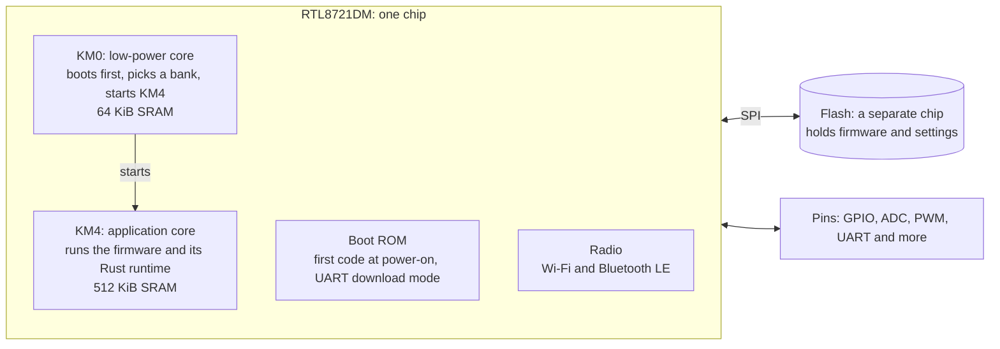

# Realtek RTL8721DM (AmebaD)

The RTL8721DM is the Wi-Fi and Bluetooth chip inside the PLAF103, and the chip Wellfed's SDK targets. This page holds facts about the chip and its vendor SDK that hold on any board. How a particular feeder wires it is on that [device's pages](../../devices/README.md).

## The chip at a glance

The RTL8721DM is a **system on a chip** (SoC). Processor cores, memory, a radio and the circuits behind each pin all sit in one package. The board around it adds the flash chip, the motor driver and the sensors.

- **Two cores.** KM4 is the fast one and runs the firmware. KM0 is the small one: it starts first, picks which firmware bank to boot and then starts KM4.
- **SRAM** is each core's working memory. It is fast and it forgets everything at power-off.
- **The boot ROM** is code built into the chip that can never change. It runs first at every power-on. It also holds a UART download mode that can rewrite flash, so the chip can always be recovered, whatever flash holds.
- **The radio** does Wi-Fi, which carries the [device API](../../firmware/device-api.md), and Bluetooth LE, which carries setup and [pairing](../../firmware/pairing.md).
- **Flash** is outside the chip, on an SPI bus. The chip runs code straight out of it.

## Cores and SDK

- **Two cores.** KM0, the low-power core, and KM4, the application core, run separate images built separately. Wellfed's KM0 image contains only `wellfed-hal-common`. The application and the Rust runtime run on KM4 ([firmware architecture](../../firmware/README.md)).
- **The vendor SDK** supplies startup, FreeRTOS, the radio stack, linker scripts and image packaging. Wellfed pins it under [`src/firmware/vendor/`](../../../src/firmware/vendor/README.md) and calls it from Rust through `wellfed-amebad-sys`.
- **Bluetooth is LE only.** The SDK's `bt_flags.h` sets `F_BT_BREDR_SUPPORT 0`, and the stack has no A2DP or LE Audio ([Bluetooth](../../firmware/bluetooth.md)).

## Pins

The SDK numbers a pin as `(port << 5) | pin`, so `PA13` is 13 and `PB3` is 35.

Some pins have a second fixed role that the board must release first. `PB3` is also `SWD_CLK`, and `PA7`/`PA8` are the LOGUART console. The [pin table](pins.md) lists every bonded pin with its SDK functions and each device's use of it.

## Memory map

These regions come from the pinned SDK's linker scripts, `project/realtek_amebaD_va0_example/GCC-RELEASE/project_{hp,lp}/asdk/rlx8721d_layout*.ld`. The table shows the KM4 (`project_hp`) TrustZone layout. The non-TrustZone `_is` variant differs only in the secure RAM split.

| Region | Start | Size | Notes |
| --- | --- | --- | --- |
| KM0 ROM | `0x00000000` | 96 KiB | Plus 16 KiB data ROM at `0x00020000` |
| KM0 SRAM | `0x00080000` | 64 KiB | ROM BSS, boot loader RAM, KM0 main RAM, MSP |
| Retention SRAM | `0x000C0000` | 1 KiB | Survives deep sleep |
| PSRAM | `0x02000000` | 4 MiB | If the package has it; first 32 bytes reserved |
| External flash (mapped) | `0x08000000` | Up to the part | Physical offsets below are relative to this base |
| KM0 image 2 (virtual) | `0x0C000000` | 32 MiB window | 32-byte header reserved; mapped onto a flash bank |
| KM4 image 2 (virtual) | `0x0E000000` | 32 MiB window | 32-byte header reserved; stock code addresses such as `0x0e0091ac` fall here |
| KM4 SRAM | `0x10000000` | 512 KiB | ROM BSS, MSP, 456 KiB main non-secure RAM, secure RAM, boot loader RAM |
| Extension SRAM | `0x100E0000` | 128 KiB | |
| KM4 ROM | `0x10100000` | 256 KiB | Plus 96 KiB data ROM at `0x101C0000` |

The SDK reserves the first 24 KiB of flash for boot material:

| Flash offset | Size | SDK role |
| --- | --- | --- |
| `0x0000` | 8 KiB | KM0 boot (XIP), 32-byte header |
| `0x1000` | 4 KiB | DPK calibration data (KM0 layout; overlaps the KM0 boot region's second page) |
| `0x2000` | 4 KiB | Backup system data |
| `0x3000` | 4 KiB | XIP system data |
| `0x4000` | 8 KiB | KM4 boot (XIP), 32-byte header |

This matches the PLAF103's `0x000000–0x006000` pre-application range ([flash layout](../../devices/plaf103/flash-layout.md)). It says where the SDK would put these things, not what a factory image holds. A device's own backup is the authority.

## Boot and download mode

- **ROM download mode.** The boot ROM enters UART download mode when the LOGUART TX line, `PA7`, is held low at cold power-on. An SDK comment naming `PA30` conflicts with that. The entry we actually tested on the PLAF103 is on its [UART page](../../devices/plaf103/uart.md#enter-download-mode).
- **Factory loader and banks.** A factory loader in the first flash sectors picks one of two application banks by their validity markers. A device's flash-layout page gives its bank offsets and selection order, for example the [PLAF103's](../../devices/plaf103/flash-layout.md); see also [bank policy](../../firmware/bank-policy.md).

## External flash

- External SPI NOR is mapped for execution at `0x08000000`. Flash offsets, mapped addresses and OTA container offsets are three different coordinate systems.
- Flash reads can be decrypted on the fly (OTF). A RAM helper that reads flash changes controller state, including the OTF configuration ([what a backup covers](../../devices/plaf103/uart.md#what-a-backup-covers)).
- **OTP, eFuse and security registers are separate from external flash.** A full external-flash backup does not include them.
- The flash clock is set by KM0's `Flash_Speed`. How fast a board can run it reliably depends on the board; the PLAF103 runs at 50 MHz ([flash clock](../../devices/plaf103/flash-layout.md#flash-clock)).

## Evidence

- **Recovered:** everything on this page comes from the pinned SDK (its linker scripts, `bt_flags.h` and HAL) and from manufacturer and SDK analysis, unless it links to a device page. The `PA7` download strap is from manufacturer and SDK analysis. The OTF side effect of the RAM helper is recovered from the helper's behavior.
