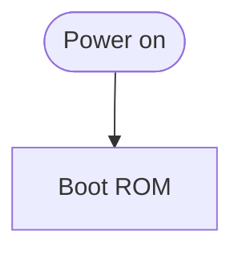

# Writing docs

This page is how we write Wellfed's docs. Most readers own a feeder and want to know what Wellfed does and how far along it is. Some go on to learn how it works, or to help build it.

## One page, one job

Every page does one of three things:

- A **guide** walks you through a task: build the firmware, read the flash, pair the CLI.
- A **reference** holds facts you look up: the pin map, the flash layout, the HTTP routes.
- An **explanation** says how something works and why it was built that way: the feeding owner, OTA banks, pairing.

The first paragraph says what the page covers and who it's for. If a page is doing two jobs, split it.

## Voice

- Talk to the reader as "you", and call the project "we".
- Keep sentences short: about 20 words, one idea each. If a sentence has three commas and a semicolon, it is two sentences.
- Put a caveat next to the thing it qualifies, as an "If…" clause. Avoid chains of parentheses.
- Say when nothing is needed or nothing happens: "No feeder needed." "This does not touch the device."
- Prefer the plain word: "use", not "utilize"; "the feeder", not "the research unit" (except in Evidence sections, where it matters which unit).

## Current facts in the body, evidence at the end

The body states what is true now and explains it. It doesn't tell the story of how we found out.

How we know goes in a short `## Evidence` section at the end of the page. Each entry carries its [evidence level](../evidence.md) (observed, recovered, modeled) and the date. Name the capture or review behind it only where that name can be public. Keep it to what supports the claims above it.

Board card ids (the `FW…`, `FP…` and `SV…` labels) never appear in tracked docs, and `cargo xtask check-repository` refuses them. Work history lives in the ignored `.agents/` folder and in commit messages. The public summary of what works is the [roadmap](../roadmap.md).

## Status

Status lives in one place, the [roadmap](../roadmap.md), plus the status column of [supported devices](../devices/README.md). Every other page links there. It may state a gap or a fact, but not a status word. The roadmap uses one closed set of words:

| Word | Meaning |
| --- | --- |
| **Works** | Done and observed on a real feeder. |
| **Partial** | Works on a real feeder, with a known gap. |
| **Experimental** | Built and tested on the host or in simulation; not yet confirmed on hardware. |
| **Not started** | Planned, nothing built yet. |

Put one word in each cell, plus a short note at most.

## Guides

- Number the steps. Start each step with the command, then say what you should see.
- Before any step that writes flash or can't be undone, add a step that checks you're about to do the right thing.
- End with **Next steps**. Add a **Common mistakes** section when people trip over the same thing.

## Warnings

Use GitHub callouts sparingly:

```markdown
> [!WARNING]
> This erases bank 0. Make a full backup first.
```

Keep `WARNING` for bricking, data loss and electrical or battery hazards. Use `NOTE` for things that are easy to miss. Place a callout at the step it applies to, not at the top of the page.

## Explanations

Lead with the one idea that makes the rest make sense. Then follow one concrete thing through the system, such as a single feed from the button press to the event the app sees. Link out to the detailed pages rather than repeating them.

## Owner pages

[`docs/guide/`](../guide/README.md) holds the pages written for someone who owns a feeder or is deciding whether to run Wellfed. They are the heart of the [docs site](../web/docs-site.md), and every other page stays on GitHub unless the site lists it. Assume a reader comfortable with a terminal and a home network, but not with this firmware. Define a term where it first appears, and link to a technical page rather than repeating it.

### App and CLI steps

Where the app and the CLI differ, write both under these markers, each on its own line:

```markdown
<!-- tabs -->

### App

Tap **Install**.

### CLI

Run `wellfed install`.

<!-- /tabs -->
```

GitHub hides the comments and shows both sections. The site shows a switch that remembers the reader's choice. App comes first, and both sections are required.

### Screenshots

A screenshot is a PNG beside the page, shown with an inline Markdown image whose alt text says what matters in it. Before one enters Git:

- Paint over anything private with a solid block, since blur and pixelation can be reversed: Wi-Fi names and passwords, device IDs, serials, MAC and IP addresses, keys and setup codes, account and people names, and notifications. Crop out the status bar where you can.
- Export a fresh PNG with no metadata, and check that with a metadata dump.
- Look at the image at full size. Keep the original out of Git.

Retake a screenshot when the screen it shows changes, since no check notices.

## Diagrams

A diagram is a hand-drawn SVG beside the page, paired with a Mermaid block that stands in for it on GitHub. The block's first line names the SVG relative to the page:

````markdown

````

The site replaces the block with the SVG. The two need not look alike, but they must say the same thing. Another page can show the same drawing by naming its path, and its block must carry the same Mermaid.

- Style the SVG only with the `.d-` classes in the docs site's [`docs.css`](../../src/web/apps/docs/src/lib/docs.css), so it follows light and dark. Give it no colors, inline styles, scripts or external links of its own.
- Give it a `viewBox`, a `<title>` and a `<desc>`, and prefix its `id`s with the file's name, since several drawings can share a page.
- Draw it about 720 units wide. The site scales it to the column and scrolls it on screens narrower than 600 px.
- `make check-web` parses every Mermaid block with Mermaid itself, since nothing else would notice one GitHub can't draw.
- `docs/diagrams.lock` holds a hash of each Mermaid block and its SVG. After changing either, compare the two, then run `cargo xtask bless-diagrams`. `make check-docs` fails until you do.

## Lists of crates and tools

Don't explain a crate list in a paragraph. Use a table:

| I want to… | Use | Read |
| --- | --- | --- |
| Read or write the feeder's flash over UART | `wellfed-flash` | [Rust flash client](rust-flash.md) |

Each full inventory lives in one place: tools in [src/tools/README.md](../../src/tools/README.md), and firmware crates in the [firmware guide](../../src/firmware/wellfed/README.md).

## Device pages

Every device folder starts from [the template](../devices/_template/README.md), so all devices answer the same questions in the same order: what it's sold as, how to identify it, the SoC and flash, UART access, recovery, its hardware blocks and notes.

## What the checks refuse

`cargo xtask check-repository` runs these over every tracked Markdown file, so `make check-docs` fails on them. `## Evidence` sections record what was true on their date, so only the anchor check reads them.

| Check | What it refuses | What it leaves alone |
| --- | --- | --- |
| Commands and flags | A `wellfed*` command in a code span or a shell fence with no such subcommand, or a flag that subcommand doesn't take. It reads each tool's clap derives, and runs nothing | Placeholders like `<review>` and `NAME`, which end the check of that line |
| Make targets | A `make <target>` the Makefile (or `-C` folder's Makefile) doesn't have | Variables like `FIRMWARE=feeder` |
| Paths | A backticked repository path that resolves to no file or folder. A shorthand may be the tail of the real path | `private/`, `.agents/`, build output, and the named vendor files. A word counts as a path only if it starts with `src/`, `docs/` or `assets/`, or ends in a source extension |
| Status | A `Status:` line, a `Status` heading or column, or a table cell holding a status word | The roadmap, supported devices, and this page |
| Time-bound wording | "come next", "on the way", "not built" and their like, and a past date in "until <date>" | The roadmap, this page, and "for now" and "not yet", which are often true |
| Anchors | A link's `#anchor` with no heading to land on, GitHub's way of writing them | Links to other sites, and `#L12` line links |

No check can catch a wrong statement about the code, such as which crates the server links. **A change to behavior updates its page in the same change.** Search the docs for the name you changed, and if a status moved, update the roadmap.

## Before you finish

- Run `make check-docs`. It checks links and anchors, card ids, private paths, and the rules above.
- Read the page once from the top as a newcomer would. If you'd skim a paragraph, cut it.
