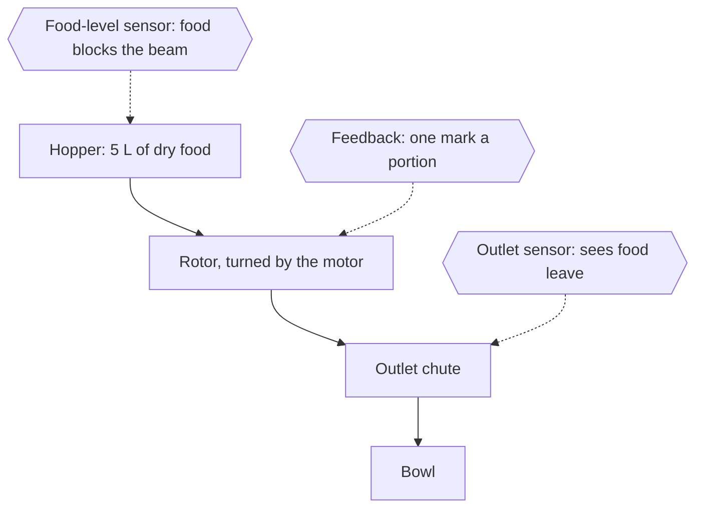
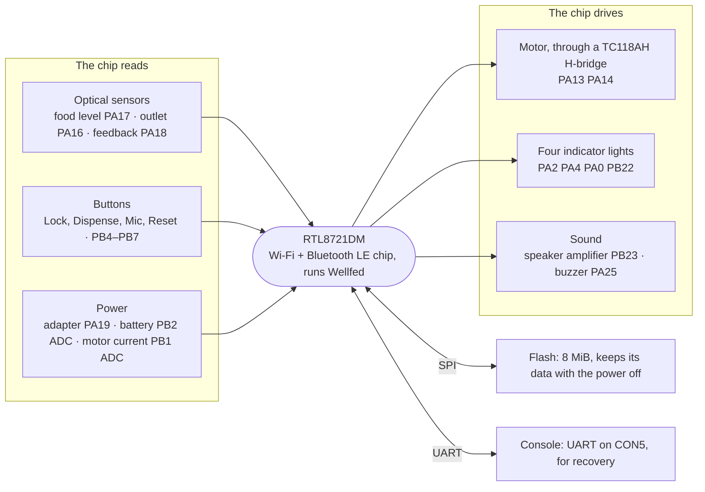

# PETLIBRO Granary PLAF103

The 5 L Granary feeder is the model Wellfed is built on. Every Wellfed feature is developed and tested on one PLAF103 on our bench. This page says how to recognize one, what is inside, and what works.

## How it feeds

Dry food sits in the hopper at the top. Under it, a small motor turns a rotor that carries food into the outlet chute, and the food falls into the bowl.

Three light beams watch the food. Each is an **emitter**, a small light, facing a **receiver** across a gap. Food in the gap blocks the beam:

- The **food-level sensor** looks across the hopper. A blocked beam means there is food.
- The **feedback sensor** sees one mark go by for each portion as the rotor turns. That is how the feeder counts what it gave.
- The **outlet sensor** looks across the chute and sees food leave.

## How the parts reach the chip

Everything runs from one chip, the [RTL8721DM](../../chips/rtl8721dm/README.md). Each part connects to one or more of its pins. A pin's name says where it sits: `PA13` is pin 13 of port A.

- A **GPIO** (general-purpose input/output) pin is either read or driven. Read, it reports high or low: a button pressed or not, a beam lit or blocked. Driven, it switches something on or off, like a light.
- An **ADC** (analog-to-digital converter) measures a voltage instead. The feeder uses two, for the battery and for the motor's current.
- The motor needs more current than a pin can give, so the pins drive an **H-bridge**. That is a motor driver chip with four switches, which can run the motor either way or brake it.
- **Flash** is a separate memory chip that keeps its contents with the power off. It holds the firmware and the settings. See the [flash layout](flash-layout.md).
- The **console** is a UART, a simple serial line on a three-hole header. Owners never need it. It is how the bench reads, writes and recovers the feeder.

The [board page](board.md) lists every pin and what we still don't know about each.

## Sold as

PETLIBRO Granary automatic feeder, 5 L, model **PLAF103**, with FCC ID **2A3DEPLAF103S**. It shipped with stock firmware 1.1.15 on our unit.

## How to identify it

- **Model and FCC ID:** PLAF103 and 2A3DEPLAF103S, on the label.
- **Board:** the [FCC internal photos](https://fccid.io/2A3DEPLAF103S/Internal-Photos/Internal-Photos-6465982.pdf) show a board marked `PLAF103 MB V1.0`. Our unit's PCB revision has not been established, so compare the markings on your own board.
- **Flash ID:** over UART the flash reports `C8 40 17`.

> [!WARNING]
> Do not assume a PLAF108 is compatible. It reportedly uses a different SoC family (ESP8266/ESP32), and nothing here has been checked on one. The other PETLIBRO models we know of are listed in [supported devices](../README.md).

## SoC and flash

| Part | What it is |
| --- | --- |
| SoC | Realtek [RTL8721DM](../../chips/rtl8721dm/README.md) (AmebaD) |
| Flash | GigaDevice GD25Q64ESIG, 64 Mbit (8 MiB) SPI NOR ([datasheet](https://download.gigadevice.com/Datasheet/DS-00484-GD25Q64E-Rev1.6.pdf)) |
| Motor driver | TC118AH single-channel H-bridge, U7, beside CON3 ([motor driver](motor-driver.md)) |
| Console | Three-hole `CON5` header: RX, TX, GND ([UART](uart.md)) |

The [board page](board.md) maps every SoC pin the feeder uses.

## UART access

The console is a 3.3 V UART at 115200 baud, 8N1, on `CON5`. To enter the ROM's download mode, you hold the feeder's TX line low through a 4.7 kΩ resistor while you power it on. The [UART page](uart.md) has the wiring and steps, and the [relay bench](bench.md) automates them.

## Recovery

You can read the whole 8 MiB flash over UART, and repeated reads match. A pinned writer has restored stock 1.1.15 to bank 1 and booted it. It only accepts our unit's exact images, so it is not a general installer. Full-bank restores and recovery from a power cut mid-write are unverified. See [recovery](recovery.md) and the [flash layout](flash-layout.md).

Most owners never need UART. Wellfed installs over stock's own updater and can go back to stock over the air; see [consumer installation](../../firmware/consumer-installation.md).

## Hardware blocks

What stock does with each block, and what Wellfed does with it. The Stock column summarizes [stock 1.1.15's behavior](stock/README.md). Where each capability stands is on the [roadmap](../../roadmap.md). All of it holds for our unit and the builds we tested. It is not a general reliability claim; see [evidence levels](../../evidence.md).

| Block | Stock 1.1.15 | Wellfed |
| --- | --- | --- |
| Console, loader and backups | ROM loader over [UART](uart.md) | Reads, writes and recovers the feeder over the same UART. |
| Startup and build identity | — | Starts with the motor stopped and reports its build. |
| Flash, journal and settings | Factory loader picks the bank | See [flash layout](flash-layout.md). |
| Stop timer and watchdog | — | Both run under Wellfed. |
| Clock and time zones | Synced by the cloud | Needs a time source after each power-up. |
| Wi-Fi | Cloud MQTT | DHCP-server loss and lease expiry are untested. |
| Local device API | None | See [device API](../../firmware/device-api.md). |
| Bluetooth LE | Wi-Fi and broker setup | Setup and pairing. |
| Updates and boot recovery | Own updater, no rollback ([requirements](stock/ota-requirements.md)) | Signed updates with rollback, and both ways between stock and Wellfed. |
| Motor and feeding | Yes | Supervised, and a power cut never repeats a feed. |
| Food, outlet and feedback sensors | Yes | The status and the low-food light show the latest food reading. |
| Power and battery | Yes | Stock's battery mode. The charge, the floor and the brownout hold are tested only in simulation. |
| Buttons and child lock | Yes ([stock](stock/README.md#panel-buttons-and-child-lock)) | The reset button clears clients, Wi-Fi, settings, plans, history and statistics. |
| Indicators | Yes | Which states show is not settled. |
| Speaker | Yes | Which sounds play when is not settled. |
| Schedules | Yes ([stock](stock/README.md#clock-and-schedules)) | Up to ten plans, run on the feeder with no server. |
| Home Assistant | Through the vendor cloud | Paused. |

$1
- Every finding comes from one research unit. Compare your own board before trusting a pin or an offset.
- There is no schematic and no complete connector pinout. The routes from the SoC to the motor driver are not traced.
- Unknown flash ranges are not free space.

## Pages

| Topic | Page |
| --- | --- |
| Signal map and connectors | [Board](board.md), [chip pin table](../../chips/rtl8721dm/pins.md) |
| Motor driver and electrical checks | [Motor driver](motor-driver.md) |
| Console and loader entry | [UART](uart.md) |
| Flash layout and boot | [Flash layout](flash-layout.md) |
| Backup and recovery | [Recovery](recovery.md) |
| Relay bench automation | [Bench](bench.md) |
| Stock 1.1.15 behavior and protocol | [Stock firmware](stock/README.md), [stock OTA requirements](stock/ota-requirements.md) |

Machine-readable device data lives in [`src/firmware/devices/plaf103/`](../../../src/firmware/devices/plaf103/).

## Evidence

- **Observed:** board photographs of the research unit identify the RTL8721DM and the GD25Q64ESIG. UART reports flash ID `C8 40 17`, which matches the GD25Q64E's nominal 8 MiB. Two separately acquired 8 MiB reads matched.
- **External:** the FCC internal-photo exhibit is a comparison reference only. The research unit's own PCB revision is not established.
