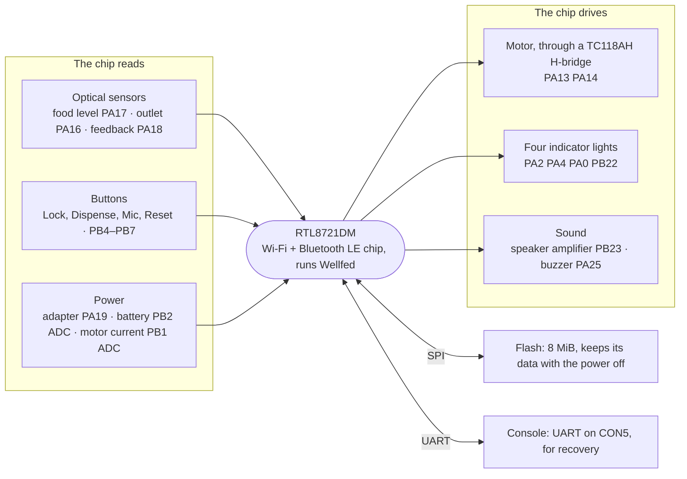

# PLAF103 board and signal map

What the PLAF103 main board connects to each [RTL8721DM](../../chips/rtl8721dm/README.md) pin, and what we still don't know about each connection. It is a reference for firmware work. Identification and support status are on the [device page](README.md).

## At a glance

The chip reads the sensors, buttons and power inputs on its left, and drives the motor, lights and sound on its right. The [device page](README.md#how-the-parts-reach-the-chip) explains each kind of connection.

## Signal map

The roles come from stock 1.1.15, and many have since been confirmed on the board. The SDK numbers a pin as `(port << 5) | pin` ([chip](../../chips/rtl8721dm/README.md#pins)).

| Signal | Role | Still unknown |
| --- | --- | --- |
| PA13 / PA14 | Motor driver inputs. Stock starts with both HIGH. | Physical direction and bowl mapping; which pin drives which driver input |
| PA18 | Portion feedback input. Rests HIGH and reads LOW at each mark, one mark per portion. Stock uses both-edge interrupts while feeding. | Mechanical phase and feedback timing |
| PA17 | Food-level input. LOW when the beam is blocked (food present), HIGH when lit. | How much food it takes to read present |
| PA16 | Outlet input and passage latch. LOW when blocked, HIGH when clear. | Passage pulses with real food, and timer activation |
| PA15 / PB3 | Emitter enables, HIGH on. PA15 lights the food receiver, PB3 the outlet receiver. PB3 is also `SWD_CLK`, so SWD must be released first. | Emitter current and duty limits |
| PA19 | External-power presence. HIGH on the adapter, LOW on batteries. | Its electrical levels and timing at the switch-over |
| PB1 | ADC motor-current estimate (channel 4) | Scaling to current, and trip thresholds |
| PB2 | ADC battery and power measurement (channel 5). Tracks the pack through a divider of about 2.06. | Battery percentage and low-voltage thresholds |
| PA25 | Active buzzer, separate from the speaker. Low at start; a HIGH alone beeps at the buzzer's own pitch (stock pulses it for 200 ms). The pad reads back what is driven. | The buzzer's part, pitch and current |
| PB23 | Audio amplifier enable. Stock holds it HIGH while the codec plays; Wellfed does the same and the speaker plays. | Electrical level and the amplifier part |
| PB4 / PB5 / PB6 / PB7 | Buttons: Reset, Mic, Dispense one portion, Lock. Active LOW with board pull-ups. | Edges finer than 2 ms, long holds and simultaneous presses |
| PA2 / PA0 / PA4 / PB22 | Indicators: low food (red), Wi-Fi and OTA (white), lock (white), warning (red). HIGH on, LOW off. | Input readback on PA0, PA2 and PA4 |

Seen from the front, the buttons run **Lock, Dispense, Mic, Reset** from left to right. The indicator icons run **low food, lock, Wi-Fi, warning** from left to right.

The buttons read high with the pad pulls off, so the pull-ups are on the board. No bounce showed at a 2 ms poll.

## Motor truth table

Stock drives the motor like this:

| Operation | Direction argument | PA13 | PA14 |
| --- | --- | --- | --- |
| Normal drive | 0 | 1 | 0 |
| Normal drive | Nonzero | 0 | 1 |
| Reverse recovery | 0 | 0 | 1 |
| Reverse recovery | Nonzero | 1 | 0 |
| Initialization and stop | Either | 1 | 1 |

Both HIGH is the driver's brake. Stock writes the two pins one after the other, and startup passes through input configuration first. This table does not say which way is clockwise. The [motor driver page](motor-driver.md) has the driver's own truth table and the electrical checks.

## Connectors

- **CON3** carries board power and the motor leads. Unplugging it also cuts board power, so it cannot isolate the motor while the board stays up.
  - **Blue and white:** the motor, a can motor with a suppression capacitor, driven by the TC118AH H-bridge beside CON3.
  - **Yellow pair:** a 3.3 V logic line and its ground, most likely the feedback sensor.
- **CON1** carries the food-level sensor, and **CON2** the outlet sensor ([test points](motor-driver.md#emitter-test-points)).
- **CON5** is the console ([UART](uart.md)).

The routes from the GPIOs to the driver are not traced.

## Stock instruction anchors

Useful addresses in the stock 1.1.15 image:

| Function | Address |
| --- | --- |
| Motor initialization | `0x0e0091ac` |
| Drive helpers | `0x0e00960c`, `0x0e009634` |
| Stop | `0x0e01d868` |
| Feedback ISR | `0x0e01a55c` |
| Sensor worker | `0x0e011b58` |
| Power worker | `0x0e011f10` |
| Indicator worker | `0x0e011738` |

See also the [relay bench](bench.md), the [flash layout](flash-layout.md) and the [firmware architecture](../../firmware/README.md).

## Evidence

- **Recovered:** every role in the signal map from stock 1.1.15, the motor truth table, and the instruction anchors.
- **Observed:** PA17 and PA16 polarity, and the PA15 and PB3 emitter roles, from the optical-input bring-up.
- **Observed:** PA19's levels on adapter and batteries, from the power-input bring-up.
- **Observed, October 23, 2026:** PB2 tracks the pack through a divider of about 2.06.
- **Observed, October 25, 2026:** PA18 rests HIGH and reads LOW for about 1.17 s at each mark, about 9 s of drive apart. Earlier empty-hopper drives that saw no edge had ended between marks.
- **Observed:** the button roles, active-LOW levels, board pull-ups and no bounce at a 2 ms poll, with the owner pressing. On October 24, 2026 the owner confirmed the front-view order. An earlier note had recorded the press order from the reverse view.
- **Observed:** a bounded diagnostic lit **PA0 Wi-Fi, PA2 low food, PA4 locked, PB22 warning**, HIGH on and LOW off, after the stock shared-pad supply prerequisite was restored. Each blinked twice and ended dark. Input reads of PA0, PA2 and PA4 still disagreed with their visible HIGH output, and interleaved UART reports were unresolved, so these are not passing electrical readbacks. See [startup diagnostics](../../firmware/startup-diagnostics.md). The owner confirmed the front-view icon order on October 24, 2026.
- **Observed:** PB23 held HIGH by the replacement firmware while the speaker played.
- **Observed:** the CON3 lead colors and the motor from owner photographs. Unplugging CON3 removed boot and loader response. Stopped-startup observations were made with the harness connected, under supervision.
