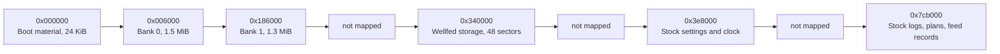
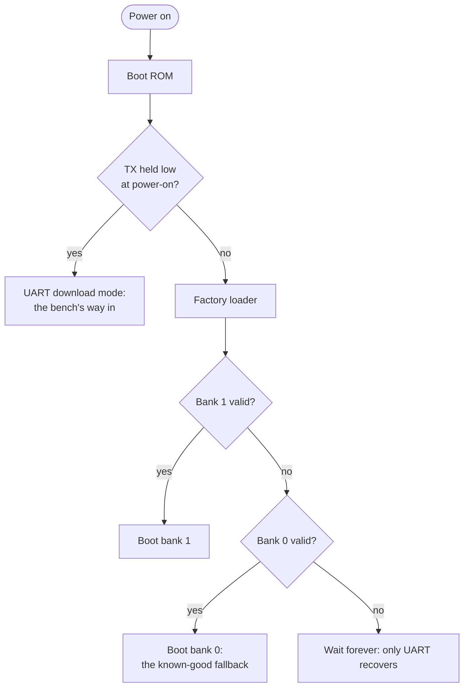

# PLAF103 boot and flash layout

This page maps what we know of the PLAF103's 8 MiB flash: the boot material, the two application banks, Wellfed's storage region and the sectors stock uses. It is a reference for anyone writing tools or firmware that touch flash.

## What flash holds

Flash is the feeder's long-term memory: an 8 MiB chip that keeps its contents with the power off. It is erased in 4 KiB **sectors** before it is written. An **offset** is a position in it, counted in bytes from the start and written in hexadecimal, such as `0x186000`.

The drawing is to scale. Most of the front half is two **banks**, each big enough for a whole firmware image. Wellfed's settings, feed journal and history live in their own small region. Stock firmware left data in a few places further on. The rest is not mapped, which is not the same as free: we don't write where we haven't checked.

## Picking a bank

At power-on the chip's boot ROM hands over to a **factory loader** at the start of flash. It boots bank 1 whenever bank 1 is valid, and falls back to bank 0 only when it isn't. That rule is what makes updates safe; [bank policy](../../firmware/bank-policy.md) explains how.

All values are flash offsets, with exclusive ends. Mapped external flash begins at `0x08000000`. The machine-readable version is [layout.json](../../../src/firmware/devices/plaf103/layout.json).

## How it boots

The PLAF103 uses the AmebaD's dual-core startup: factory loader and configuration first, then the application banks ([chip memory map](../../chips/rtl8721dm/README.md#memory-map)). Stock 1.1.15 loads its KM0 and KM4 image regions and picks an application bank by its validity marker. The factory loader checks bank 1 first and falls back to bank 0 ([bank policy](../../firmware/bank-policy.md)).

## The map

| Range | Role |
| --- | --- |
| `0x000000–0x006000` | Factory and pre-application material. Preserve. The SDK places KM0 boot, calibration, system data and KM4 boot here. |
| `0x006000` | Bank 0 start |
| `0x186000` | Bank 1 start, the stock recovery target |
| `0x186000–0x2d6000` | Stock's footprint in bank 1, as reviewed |
| `0x340000–0x370000` | Wellfed's storage region, 48 sectors ([below](#wellfeds-storage-region)) |
| `0x3e8000–0x3f0000` | Stock settings sectors |
| `0x3f0000–0x400000` | Stock clock-checkpoint block. Stock block-erases it when it saves the clock. Preserved (`clock_checkpoint_block`). |
| `0x400000–0x401000` | Stock audio-start sector |
| `0x7cb000–0x7cc000` | Stock log sector |
| `0x7d0000–0x7d7000` | Stock plan and feed-record sectors: the plan count and entries (`0x7d0000–0x7d2000`, [plan records](stock/README.md#plan-records)), four record-ring indices, then the feed records |
| `0x7da000–0x7db000` | Stock error-record sector |

This is not a complete partition map. **Unknown gaps are not free storage.** Physical flash ends at `0x800000`. The OTP, eFuse and security registers sit outside it and are not in a normal flash backup.

## Wellfed's storage region

The region is `STORAGE_OFFSET`/`STORAGE_SECTORS` in firmware, and `wellfed_board_plaf103::storage` names the owner of every sector.

| Sectors | Owner |
| --- | --- |
| 0–1 | Feeding journal |
| 2–3 | Settings |
| 4 | Confirmation record |
| 5–6 | Wi-Fi credentials |
| 7–8 | Seed |
| 9–10 | Clients |
| 11–12 | Plans |
| 13–24 | Event ring |
| 25–26 | Update store |
| 27–28 | Time settings |
| 29–31 | Per-feed traces |
| 32–33 | Lifetime statistics |
| 34–35 | Portion calibration |
| 36 | Factory reset marker |
| 37–39 | Free |
| 40–47 | Meal call clip |

The region only grows upward. A sector keeps its address, and a build compiled for a smaller region never reaches the sectors added after it.

No flash tool writes this region. The development, update and stock-recovery writers stay inside their bank, and stock recovery also verifies that everything outside bank 1 is unchanged.

## Flash clock

Wellfed runs the flash at 50 MHz in Dual IO mode, set through KM0's `Flash_Speed`. At 80 MHz, over-the-air downloads into bank 0 hit random faults and single-bit read errors on our unit. At 50 MHz the boot calibration window is wider, and those faults have stopped in every install so far (8 of 8). We'll treat the fix as settled once the long unattended run passes. Quad IO is not used, because its check fails at the slow boot clock.

## OTA images and the layout

The pinned stock OTA file is 1,376,288 bytes, including a 32-byte container header. Its SHA-256 is `05147476fc70c91cc77ad7da6d6772376b2081d460ac7b1912e2d73868a09498`. OTA container offsets and raw flash offsets are different coordinate systems.

Our structural auditor checks an image's checksum, declared lengths, headers, load addresses, placement and the known preserve ranges. It does not prove that the factory loader will boot a new image. [Stock OTA requirements](stock/ota-requirements.md) separates what stock checks from our stricter profile and from the factory loader's needs.

The flags in `layout.json` stay conservative: the map is incomplete, there is no general guarantee of verified capacity, and no general guarantee that an image boots. Read coverage and diagnostic boots apply to the research unit and the exact images tested.

The SDK's `device` and `firstboot` profiles overlay the stock-derived bank addresses and startup pin pulls. They do not replace or validate the SDK's separately generated bootloader, and generated loader files are unsupported. See [build profiles](../../development/firmware-builds.md) and [recovery](recovery.md).

## Evidence

- **Recovered:** the SDK's placement of boot material in `0x000000–0x006000`, and stock's block erase of the clock-checkpoint block on its clock save.
- **Observed:** the stock settings, audio-start, log, plan-record and error-record sectors.
- **Modeled:** running the factory loader's instructions against modeled ROM and MMIO accepts the reviewed diagnostic in both bank fixtures. It is not a full reset-path or power-cut simulation.
- **Storage region growth:** the owner extended the region from 16 sectors on October 23, 2026, and from 32 to 48 on October 26. Both rest on a static pass that found no stock access in `0x306000–0x3e8000`, and on all 15 full dumps reading blank there ([resource budget](../../firmware/resource-budget.md)).
- **Observed, October 27, 2026 (flash clock):** at 80 MHz, bank 0's downloads faulted at random sectors and one readback returned a single flipped bit. At 50 MHz the calibration window read 29–31 over 15 boots, against 11–17 at 80 MHz, and 8 of 8 alternating over-the-air installs through bank 0 passed with no fault. That is one evening's runs, not yet a sustained run.
