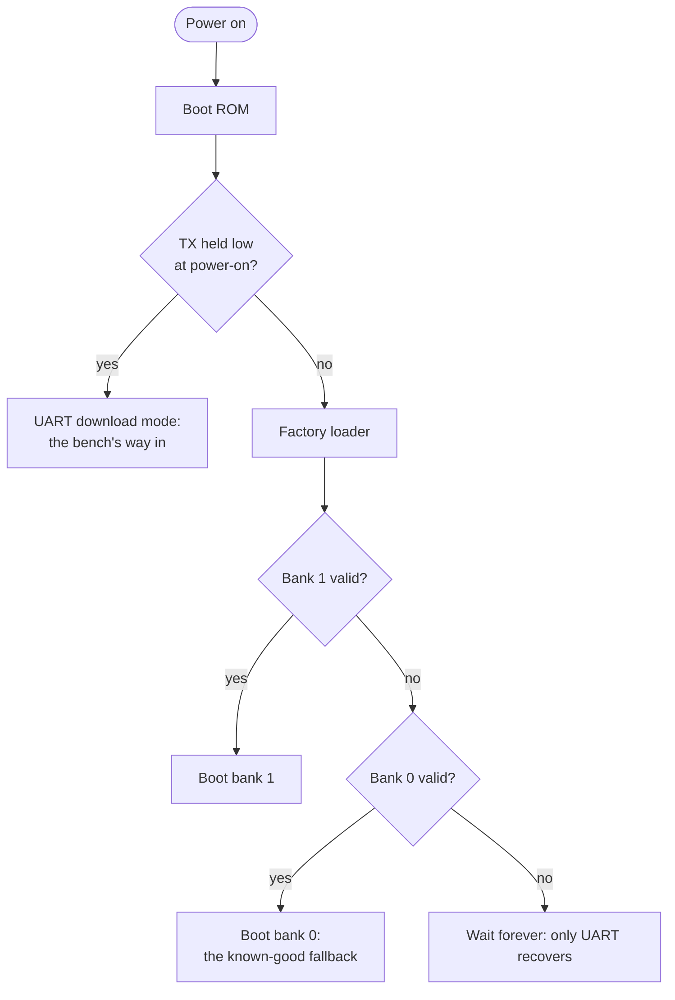
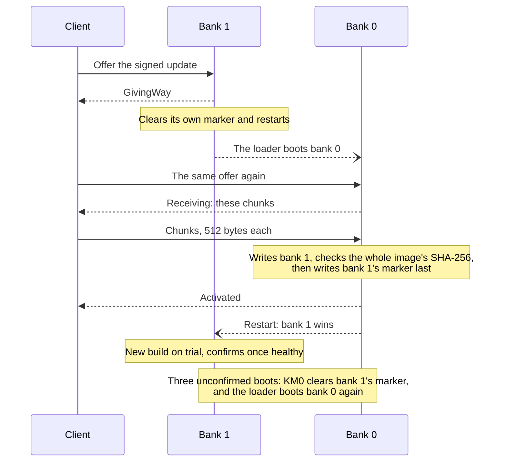

# Bank policy

This page explains how the feeder's factory loader picks which of its two firmware banks to boot, and the rules Wellfed follows so a feeder always has something to boot. It is for owners curious why updates are safe, and contributors touching the updater. How an update moves between the banks is in [OTA design](ota-design.md), and the bench checks are in [bank, install and rollback bench checks](install-bench-checks.md#checking-the-bank-rules).

## In short

The feeder has room for two firmware images. At power-on it boots bank 1 whenever bank 1 is valid; bank 0 holds a known-good build and boots only when bank 1 can't.

## An update, start to finish

An update never overwrites the running build. Bank 1 hands over to bank 0, which writes the new build into bank 1. The new build runs on **trial** and confirms itself once it has started cleanly; if it keeps failing, KM0 sends the feeder back to bank 0.

## The one rule: bank 1 wins

**Bank 1 has fixed priority; bank 0 is only a fallback.**

| Bank 1 (`0x186000`) | Bank 0 (`0x006000`) | Boots |
| --- | --- | --- |
| valid | invalid | bank 1 |
| valid | valid | **bank 1**, whatever either image holds |
| invalid | valid | bank 0 |
| invalid | invalid | neither: a wait loop at `0x08000482`, with no automatic UART fallback |
| KM0 valid, KM4 invalid | — | neither: a warning loop at `0x08000182`; the other bank is not tried |

A bank counts as valid when its image starts with the 8-byte marker `81958711` (ASCII), followed by valid KM0 and KM4 signatures.

With the force-bank GPIO disabled, the loader checks bank index 1 first (`0x08000456`) and returns it if its signatures pass, and only on failure checks bank 0 (`0x0800043a`). The both-valid row held for stock in both banks, our image in both, and each mix, and the build's audit requires it.

**How stock moves between banks.** Stock 1.1.15's activation (`0x0e02a648`) writes the new image's marker last, then programs one word over the start of the opposite bank's marker, clearing bits in its first four bytes (physical observation, October 29, 2026: bytes 0–3 changed and 4–7 kept; the one-word program is inferred from that and the static read). Given bank 1's priority, that clearing is what lets stock move from bank 1 to bank 0.

## Capacities

| Bank | Start | Reviewed limit | Space |
| --- | --- | --- | --- |
| 0 | `0x006000` | `0x186000` (bank 1 start) | 1.5 MiB |
| 1 | `0x186000` | `0x2d6000` (stock's footprint, the development updater's bound) | 1.3125 MiB |

Bank 1 could extend further: the next known use is the replacement's storage at `0x340000`. Unknown gaps are not free space, though, so the reviewed bound stands.

Replacement images run from 684,032 bytes (`blink`) to 1,015,808 bytes (the current `feeder`), 50–74 % of the smaller bank ([resource budget](resource-budget.md#flash)). The factory mapper sizes its windows from the image headers, rounded up to 4 KiB.

## One image runs from either bank

The mapper translates each bank's physical start to the same virtual addresses, `0x0c000000` for KM0 and `0x0e000000` for KM4, so one image runs from either bank without relinking. The emulated mapping is identical for stock and our image in both banks, and stock's updater writes the same container to either. On the feeder the same replacement image has run from both banks, and today both run the `feeder` build. The `device` build profile's OTA-address header matters only to the SDK's own OTA writer, which the replacement doesn't use.

## Rules for the replacement

1. **A new build goes into bank 1, with its marker written last,** after the rest of the image is verified. Bank 0's update stage and the development updater both work this way.
2. **Bank 0 holds a known-good fallback,** not a peer. It boots only when bank 1's marker or signatures fail. It runs the full `feeder` build: it serves the device API and feeds, so a failed update lands on a feeder that still works. It is the only bank that writes bank 1 ([OTA design](ota-design.md#updates-over-the-device-api)).
3. **Never leave both banks invalid.** The loader then waits forever, and only the UART loader recovers. Any marker write must keep at least one valid bank.
4. **To give way to bank 0, clear bank 1's marker.** Bank 0 cannot win while bank 1 is valid.
5. **Bank 1 gives way only to the bank 0 it knows.** At boot, bank 0 records its build, its image's length (from the bank's own headers) and its SHA-256 in the update store. Bank 1 hashes bank 0 again before a give-way, and refuses when bank 0 changed or never recorded itself, naming which check failed. It runs the same check once per boot and publishes the result in the update state, so a bank 0 written over UART shows as blocked before an offer is refused. A bank-0 write counts as finished only once bank 1 reports that check as `match`. So a give-way never lands on a build that cannot take the offer.

## When a new build won't start

The loader offers no recovery of its own: an image with a valid marker that crashes after boot is selected again on every reset. Wellfed has two ways out.

- **UART.** The ROM loader lives in ROM, independent of flash, so the relay bench can always enter it and reinstall bank 1.
- **Firmware fallback.** A new build in bank 1 starts on trial ([OTA design](ota-design.md#boot-confirmation-and-fallback)). KM0 counts unconfirmed boots in a backup register before KM4 starts (a power cut, which clears the register, only restarts the count). After three, it clears the first byte of bank 1's marker (one page program, before any other core runs) and resets, and the loader boots bank 0. A build confirms once its startup, stopped outputs and link are healthy and, with a feeding owner, that owner has opened at rest ([what confirmation proves](ota-design.md#what-confirmation-proves)). A confirmed build that keeps resetting soon after every boot gives way the same way, or is held or halted ([reset storms](ota-design.md#reset-storms)).

The fallback only helps if the new build's KM0 code works: a broken KM0 or factory configuration still needs UART. The watchdog is what turns a KM4 hang into a counted reset.

## Evidence

- **Modeled:** `wellfed-emu`'s factory module executes the factory loader's own instructions, taken from the research unit's verified 8 MiB backup, with the candidate B-cut ROM's mapping routines. The ordinary selection slice (`0x080003f4`) runs with this unit's initialized configuration: no selection or firmware-check callback, and the force-bank GPIO disabled (`0xff`). This produced the selection table.
- **Modeled:** the chained three-step sequence passed in emulation. The real helper instructions performed each write, and the factory loader's own selection code picked each boot.
- **Recovered:** stock's activation order, from static analysis of stock 1.1.15.
- **Observed** (October 22, 2026, research unit, relay bench): the three steps, with the same replacement build (startup identity `8d67a407…`) in both banks:

  | Step | Write | Boot report |
  | --- | --- | --- |
  | A | That image into bank 0 (145 sectors, marker last), over the invalidated October 19 probe residue | `bank=1`: both valid, bank 1 kept |
  | B | Give-way: bank 1's first marker byte cleared (one frame, no erase), with bank 0 read in full and equal to the review | `bank=0`, MMU offset `03ffa000`: the image runs unchanged from bank 0 |
  | C | Restore: bank 1's first sector rewritten, marker last | `bank=1`, MMU offset `03e7a000` |

  Every step verified its readback, and every boot passed stopped-output startup and ran the LED and optics probes. No loader NAK occurred. Full-flash reads before step A and after step C differ only in bank 0's application region (`0x6000`–`0x97000`). Bank 1, the factory region, settings and storage were byte-identical. This was the first run of the replacement from bank 0, and it passed with both UART clients.
- **Observed:** UART recovery of bank 1 through the ROM loader, used for two interrupted recoveries on the bench.
- **Limits of the model:** it is the selection slice from supplied state, not a full reset or a power cut mid-write. It does not cover the force GPIO, non-null callbacks, security checks beyond the observed null callback, or damaged factory configuration. The candidate ROM matches sampled device words, but its mapping routines were not among the words verified physically.
