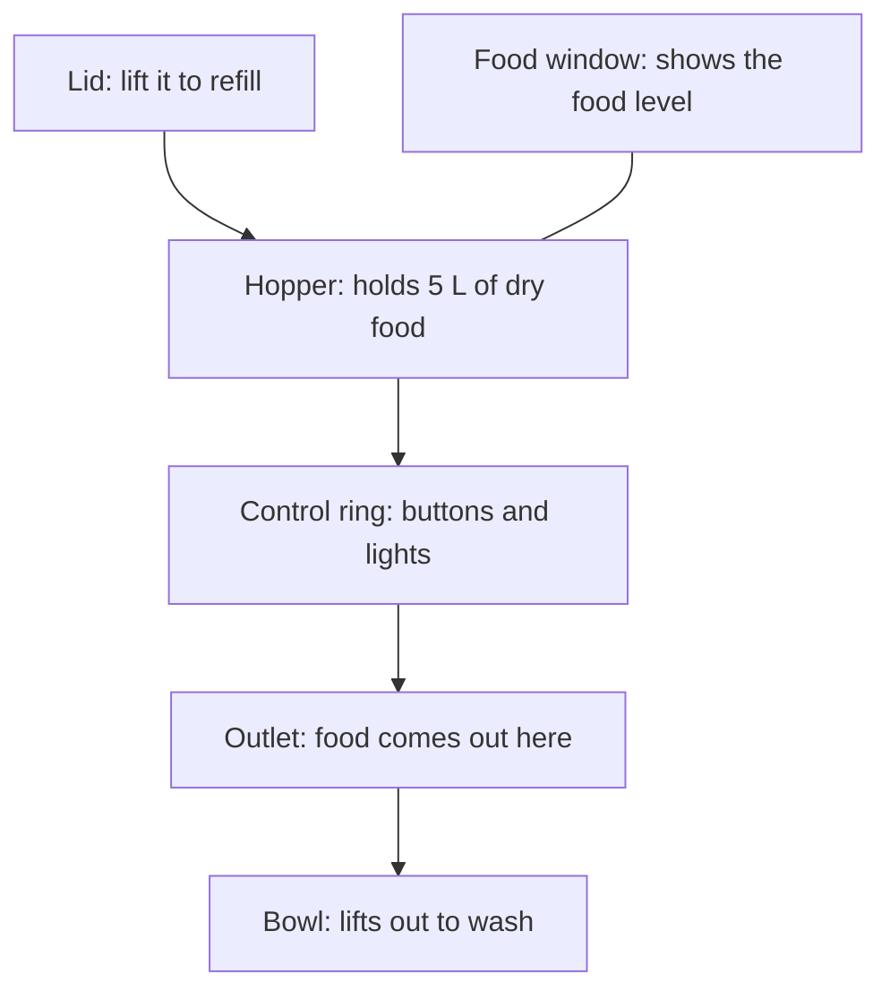

# Wellfed

Wellfed is open firmware for the PETLIBRO Granary PLAF103 pet feeder. It runs the feeder on your own Wi-Fi, with no vendor cloud and no account. These pages are for you if you own one, or if you're deciding whether to run it.

> [!NOTE]
> Wellfed is in heavy development and has run on one test feeder. It isn't ready to look after a real pet yet, and there's no public build to install. The [roadmap](../roadmap.md) shows where each piece stands.

## What you get

- **Meals that don't depend on a cloud.** Up to ten meal plans run on the feeder itself, so a vendor outage doesn't matter. The feeder does need a time source: after a power cut, or hours without one, scheduled meals hold until the clock is set. The Dispense button still works once you unlock the panel.
- **No account.** Your phone talks directly to the feeder over your network, encrypted, and nothing goes to a cloud.
- **Feeding you can check.** Each feed stops on time, a power cut never makes it feed twice, and a jam we injected ended the feed by name in the history. A real jam hasn't happened on our bench.
- **A way back.** The install saves a checked copy of the vendor's firmware to your phone or computer, and you can put it back over the air.
- **Something to build on.** An Android app, a command-line client and an encrypted local API all do the same things. An optional server is a proof of concept.

## What you give up

- **The vendor's app and cloud**, for as long as Wellfed is on the feeder.
- **Your current meals.** Installing erases them, and you set them up again in Wellfed.
- **A support line.** This is an independent project, and we're not affiliated with or endorsed by PETLIBRO.

## Is it for you today?

Not yet, as an owner: there's nothing public to install. Follow the [roadmap](../roadmap.md) and come back after a first release. If you'd like to help build it, start with the [development guide](../development/README.md).

## Where to go next

| You want to | Read |
| --- | --- |
| Check your feeder and what you'll need | [Before you start](before-you-start.md) |
| See what an install involves | [Install](install.md) |
| Learn meals, buttons and lights | [Everyday use](everyday-use.md) |
| Put the vendor's firmware back | [Going back to stock](going-back.md) |
| See how the pieces fit | [The system at a glance](how-it-works/system.md) |
| Know how an install avoids stranding your feeder | [Install and rollback](how-it-works/install-and-rollback.md) |
| Know why a feed can't run twice, and its limits | [How feeding stays safe](how-it-works/feeding-safety.md) |
| Know who can reach your feeder | [Who can talk to your feeder](how-it-works/access.md) |
| See what works and what doesn't | [Roadmap](../roadmap.md) |
| Run the optional server | [Running the server](../server/running.md) |
| Help build it | [Development guide](../development/README.md) |

## Evidence

- **Observed, October 2026.** The features above ran on one research feeder. The [roadmap](../roadmap.md) gives each one's limits.
