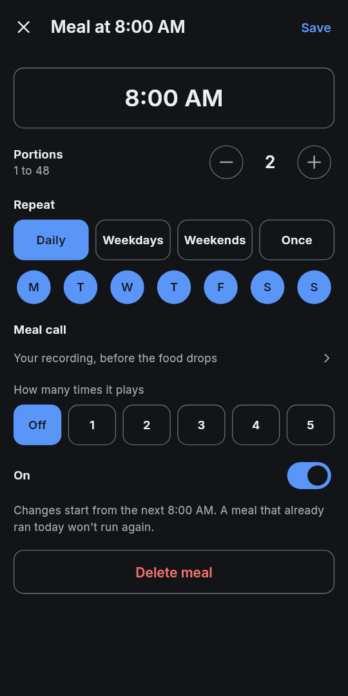
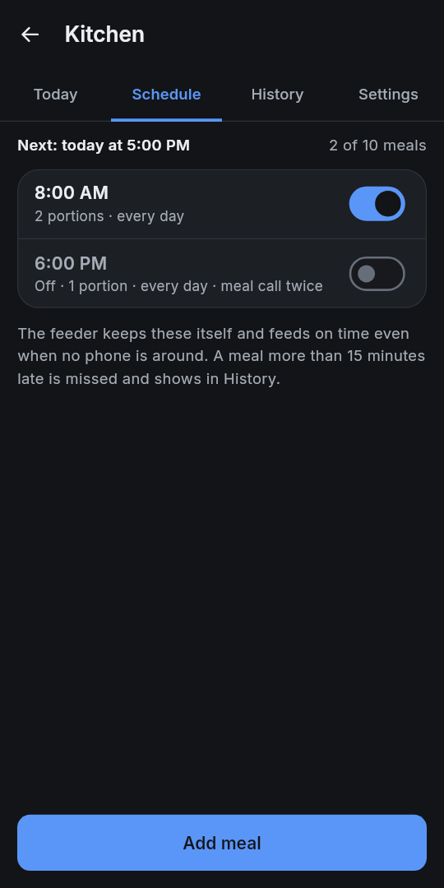
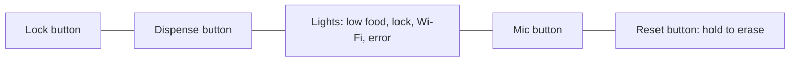
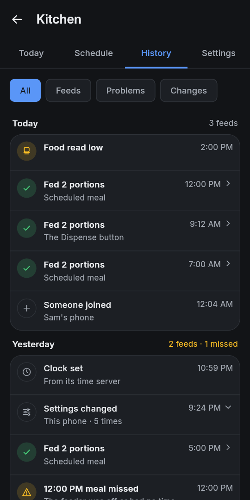

# Everyday use

This page covers life with a feeder running Wellfed: meals, feeding now, the buttons and lights, refilling and what happens when something is down. It is for owners, and each task starts with the app.

> [!NOTE]
> There's no public build to install yet, so this describes Wellfed as it runs on our test feeder. The [roadmap](../roadmap.md) shows how far along each piece is. Don't rely on it alone to feed a pet yet.

The app has one screen per feeder, with four tabs: **Today**, **Schedule**, **History** and **Settings**. The app talks to the feeder directly on your home network, so away from home it can't reach it.

The CLI keeps your key and your stock backups in one folder, whichever folder you run it from: `~/.local/share/wellfed` on Linux (or `$XDG_DATA_HOME/wellfed`) and `~/Library/Application Support/io.github.isaacduarte.wellfed` on a Mac, the two systems the CLI runs on. Set `WELLFED_HOME` to use another folder, or pass `--keys`. It makes a key only when you ask: the first time on a computer, add `--create-key` to `wellfed setup`, `wellfed recover` or `wellfed join`. Any other command with no key stops and names the file it looked for.


When something needs you, Today says so. A feed cut short by a power loss gets a notice above the meals, and batteries, a weak signal or overdue desiccant move out of the line that says all is fine into rows of their own.

## Meals

The feeder keeps up to ten meals and runs them itself, so no phone or computer has to be around. Each meal has a time, 1 to 48 portions, and the days it repeats on. A meal set to run once stays in the list, switched off, after it has run.

<!-- tabs -->

### App

Open **Schedule** and tap **Add meal**. Set the time, the portions and how it repeats, then tap **Save**. Tap a meal to change or delete it, and use its switch to turn it off for a while.



### CLI

```sh
wellfed plans list
wellfed plans add --at 07:30 --portions 2 --days daily
wellfed plans edit 0 --days mon,wed,fri
wellfed plans disable 0
wellfed plans delete 0
wellfed plans skip 0
wellfed plans unskip 0
```

A meal's number is its slot, as `wellfed plans list` shows it.

<!-- /tabs -->



A few rules are worth knowing:

- **A new meal starts from its next occurrence.** Saving a 07:30 meal at 07:35 feeds tomorrow, not now.
- **Moving a meal can feed it again the same day.** Changing a meal's time or days starts it afresh. Move a 07:30 meal that already ran to 12:00, and it feeds again at 12:00. The editor's note that a meal that ran won't run again holds only while the time stays put.
- **Skipping one meal.** You can skip a meal's next run if it falls today and hasn't come due, and undo the skip until it does. In the app, tap **Skip** on the meal's line on **Today**, then **Skip meal**; the line then shows **Skipped** with **Undo** until the meal's time. The meal doesn't feed, remind or call, and tomorrow's runs as usual. History shows who skipped it.
- **A late meal has 15 minutes.** If the feeder restarted or was busy, the meal still runs within 15 minutes of its time. Later than that, it doesn't run, and History shows it as missed.
- **Two people editing at once.** If the meals changed while you were editing, the change is refused and nothing is overwritten. Read them again and redo your edit. The CLI sees the same refusal as `Stale`.

### Before a meal

**Meal call** plays your own recording before a meal, up to five times, and ends as the meal is due. Uploading a recording takes an owner. In the app, open **Settings**, then **Meal call** (or the meal editor), and either tap the round record button or **Use an audio file instead** to choose a WAV file. Tap it again to stop and send; a recording stops by itself at 8 seconds, and the app asks for the microphone the first time. Another file format, such as MP3, needs converting to WAV first, for example with `ffmpeg -i call.mp3 call.wav`. The play button beside your recording plays it once on the feeder so you can hear it; anyone with the feeder can do that. On the CLI, it's `wellfed call upload dinner.wav`, then `wellfed plans edit 0 --call 2`. With sound off or outside its hours, the meal runs silently.

**Before each meal**, under Settings and Reminders, adds a **Meal coming** entry to History up to 60 minutes ahead. On the CLI, it's `wellfed settings --meal-reminder 10`. It's only a history entry: it plays nothing and sends no notification. Alerts are separate: the app notifies the feeder's alerts, such as a failed or missed meal, low food or a feeder that can't feed ([the app's alerts](../../src/app/README.md#alerts)).

## Feeding now

<!-- tabs -->

### App

Tap **Feed now**, choose 1 to 48 portions and confirm. You can close the sheet, and the result shows on the feeder's card and in History. While it runs, **Stop feeding** asks the feeder to stop. What has already dropped stays in the bowl.

### CLI

```sh
wellfed feed --portions 2
```

It prints the feed's number and waits for the result. On a long feed, it can give up waiting after 2 minutes while the feed carries on. Don't feed again: read `wellfed feeds` once it has had time to finish. To stop it, run `wellfed cancel-feed <feed>` from another terminal.

The exit status says how it went: 0 for a feed done, 1 for an error or a feed that ended without its portions, and 3 when the CLI can't tell whether it ran. Every other change the CLI sends exits the same way, and it never sends one again on its own.

<!-- /tabs -->

A portion takes about 10 seconds. The feeder runs one feed at a time, and scheduled meals still run after a feed you start yourself.

If the app asks whether the feeder fed, or says **Fed between 0 and 3 portions**, the feeder can't say how much dropped. Look at the bowl before you feed again. The app and the CLI won't send that feed again, and neither will the feeder. [How feeding stays safe](how-it-works/feeding-safety.md) explains why.

## The buttons and lights



**The buttons start locked.** The panel locks at every boot and locks itself again after about 30 seconds with no presses. A locked panel ignores Dispense and the Reset hold. Scheduled meals and feeds from the app or the CLI aren't affected.

| To | Do this |
| --- | --- |
| Lock or unlock the buttons | Hold Lock for 5 seconds, tap **Buttons locked** or **Buttons unlocked** beside the drawing on Today, or run `wellfed lock off` |
| Feed one portion | Press Dispense on an unlocked panel |
| Start Bluetooth setup | On an unlocked panel, hold Lock, then Mic, for 5 seconds. No feed runs during setup, which ends after 15 idle minutes, so an accidental hold can skip a meal. `wellfed reboot` on the CLI ends it sooner |
| Add this phone back when no phone can reach the feeder | On an unlocked panel, hold Lock, then Dispense, for 5 seconds. Then, within 2 minutes, choose **Recover a feeder** in the app or run `wellfed recover`, and key in the code it shows |
| Erase people, Wi-Fi, meals, settings and history | On an unlocked panel, hold Reset for 5 seconds |

> [!WARNING]
> Holding Reset wipes the feeder and draws a new identity. The backup of the vendor's firmware stays filed under the old identity, so the app no longer finds it for this feeder, and you'd need the copy you saved. If you didn't save one, the app's settings still list the copy under **Firmware backups**, named by the old identity once the feeder is no longer in your list, so you can share it. We haven't tried that rescue. Portion size and the record of past feed numbers are kept.
>
> The feeder then waits for Bluetooth setup, so choose **Add a feeder** on your phone.

| Light | Steady | Blinking |
| --- | --- | --- |
| Low food (red) | The food beam reads low | About once a second: a feed is running |
| Lock (white) | The buttons are locked | About twice a second: waiting for a pairing code |
| Wi-Fi (white) | The feeder has an address on your network | Once a second: Bluetooth setup. Quickly: installing an update |
| Warning (red) | A fault stopped feeding until a restart | Quickly, for 3 seconds: a press was refused. Every 2 seconds: batteries too low to feed |

Which states show is still provisional. With **Lights** off, or outside their hours, every light is dark, including the warning. **What do the lights on the feeder mean?** on Today has a short key. Where it differs from this page, this page is right.

## Refilling and the desiccant

Lift the lid and pour in dry food. You don't need to tell the app. On mains, the feeder reads the food beam about once a minute, so the low-food light clears within a minute or so. On batteries, it reads the beam only during a feed.

The food beam is a low warning, not a gauge. It sits above the rotor and reads low with about five portions left on our test feeder. A feed still runs when the food reads low, and tapping it in History shows the food level.

The desiccant reminder counts days from your last change, every 14 days until you change that. Settings has the period, from 1 to 90 days.

<!-- tabs -->

### App

Tap **Mark changed** in Settings after you put in a fresh pack. Once a change is due, Today shows how many days overdue it is, with its own **Mark changed**. Until then, Today folds it into one line with power, Wi-Fi and the clock: tap that line to see the days left. The first time, the count begins when you tap.

### CLI

```sh
wellfed desiccant --reset
wellfed desiccant
wellfed settings --desiccant-days 21
```

<!-- /tabs -->

The feeder needs a set clock to record a change. It has no sound or notification for this: you see it on Today, or with `wellfed desiccant`.

## Weighing a portion

The feeder counts portions, not grams, and what a portion weighs depends on your food. One portion of the dry food we tried weighed about 7 g. The weight is only used for estimates, and it never changes how far the motor turns.

Feed one portion first and throw it away, so the rotor starts from a known place. Then feed 10 portions into an empty bowl and weigh them.

<!-- tabs -->

### App

In the app this takes an owner. Open **Settings**, then **Portion size**. Tap **Enter what 10 portions weighed** and enter the grams, or step the size a gram at a time with **−** and **+**.

### CLI

An owner or a member can run this.

```sh
wellfed calibrate --weighed 71.1 --portions 10
```

<!-- /tabs -->

## History

**History** lists what happened, newest first: feeds, missed and skipped meals, restarts, changes and who made them. Filter it with **Feeds**, **Problems** or **Changes**, and tap a feed for its detail. On the CLI, use `wellfed feeds` for the feeds and `wellfed events` for everything.



A feed that was interrupted reads as a range, such as **Fed between 0 and 3**, because the feeder can't know how far it got. **Fed 2 of 2** counts rotor marks. It doesn't mean the food reached the bowl, and the feeder never knows what your pet ate.

The feeder keeps the last 1,408 events or more. That is a few months of an ordinary feeder's history, and at least a week of a very busy one's ([how many days it holds](../firmware/device-api.md#events-and-samples)).

## When something is down

Your feeder needs the time to run meals, and it has no battery-backed clock. "No internet" can still matter, since the default time source is the gateway on your network, usually your router.

| What's down | Scheduled meals | Feeding by hand |
| --- | --- | --- |
| Your phone | They run, unless the clock depends on that phone (below) | Dispense works. Feed now needs a phone or computer |
| The internet, with your router still on | They run if your router still answers with the time. A router that says its own clock isn't set is refused. How routers behave here varies, and we haven't tested it. To check yours, see whether **Clock** on Today reads **Set by your router** | Dispense and Feed now work |
| Your Wi-Fi or router | They run until the clock's possible error passes 2 minutes, then they hold. That limit counts from the last time the clock was fully set, not from the last poll, so it can come any time up to about 6.6 hours after the drop, or about a week once your syncs have taught the feeder its clock's rate ([clock](../firmware/clock.md#the-clock)) | Dispense works. Feed now needs Wi-Fi |
| Mains, with no batteries | Nothing runs while it's off. The clock is lost, so meals hold until it's set again | Dispense works once power is back |
| Mains, with batteries | They run while the clock stays good, then hold until mains returns and it's set again. Wi-Fi turns off after 5 seconds. Below the batteries' floor, no feed starts | Dispense works. Feed now doesn't work until mains returns |

"Dispense works" always means on an unlocked panel, and the panel is locked after a restart. While the feeder is trying to rejoin Wi-Fi, a press can be refused and the warning light flashes, and during an outage it keeps trying. Press again a little later. A meal is retried by itself within its 15 minutes.

After a power cut, your plans come back but the clock doesn't. If your router answers, the clock is set soon after the feeder rejoins Wi-Fi. Otherwise, open the app on the same Wi-Fi: it gives the feeder your phone's time when it connects to a feeder with no clock, and Today offers **Set the time from this phone**. On the CLI, run `wellfed time`.

The feeder also needs your time zone, since meals are set in local time. The app stores your phone's zone when you set a feeder up; **Settings** → **Clock** shows it, and offers **Use this phone's zone** when the feeder keeps a different one. Without one, the feeder uses the offset a phone last gave it, which a power cut erases: the clock comes back right from the router or a time server, but every meal holds until a phone gives the offset again. The app does that as soon as it connects, and the **Today** tab says **Meals are on hold** until then.

When the time returns, a meal less than 15 minutes late runs, and an older one is missed. On a day with a long outage, feed your pet another way.

Even with your router answering, the clock reads invalid for up to a minute about every 6.6 hours (about weekly once your syncs have taught it its rate), until the next poll sets it again. A meal due in that minute runs once it's back.

A longer limit, about a week, needs two `wellfed time` syncs from an owner about 11 hours apart. The feeder forgets that on every restart, and the app doesn't do it.

An owner chooses where the time comes from, with **Get the time from** on the **Clock** screen: **Your router**, **A time server** or **Phones only**. An address has to be an IP address, since names aren't looked up. Many home routers don't answer with the time. When yours doesn't, the feeder's **Today** tab offers Cloudflare's public time server, or phones only. Either choice ends the offer. Out of the box the feeder asks only your router, so it contacts nothing outside your network unless you choose it. **A time server** also lists public time servers from Cloudflare and Google to pick with one tap. On the CLI, use `wellfed time --ntp gateway`, and `wellfed time --show` to see the clock.

**Phones only** needs something to set the clock at least every 6 hours or so, such as a timer that runs `wellfed time`. The app doesn't do this by itself: it sets the clock only once it's lost, when you open the app, and by then meals are already holding.

## Naming a feeder

A feeder's name is your phone's own: tap **Name** under **On this phone** at the bottom of the feeder's **Settings** tab. It works with the feeder offline, and someone else's phone keeps whatever name they gave it.

## Reaching a feeder away from home

The app finds a feeder by its announcement on your Wi-Fi, and that announcement doesn't cross a VPN. To reach the feeder through one, such as a Tailscale subnet router on a computer at home, give the app its address. Tap **Address** under **On this phone** in the feeder's **Settings** tab, and type its IP address, such as `192.168.1.20`. The app adds the port, 4747, when you leave it out. From then on, this phone dials that address whether you're home or away. Leave the field blank to go back to finding the feeder on your Wi-Fi.

The feeder itself runs no VPN, so the computer at home forwards to it. Its address has to stay the same, so reserve it in your router's DHCP settings. The address only says where to dial: the app still checks the feeder's key, so a wrong address fails to connect and can't pass for your feeder. Firmware updates and going back to the original firmware still need your phone on the same Wi-Fi as the feeder.

## People and invites

An owner can do everything. A member can feed, edit meals and settings, and lock the buttons. In the app, the Wi-Fi, clock, meal call, people and firmware screens show only for an owner. A feeder lists up to eight phones, computers and keys in all.

<!-- tabs -->

### App

Open **Settings**, then **People**, and tap **Invite someone**. Choose **Member** or **Owner**, then show the code or share the link. On their phone, on the same Wi-Fi, they choose **Add a feeder**, then **Join with an invite**. Remove someone from the same screen, and their connection closes at once.

### CLI

```sh
wellfed invite --role member
wellfed join <invite>
wellfed clients
wellfed revoke <key>
```

<!-- /tabs -->

An invite works once and runs out after 10 minutes, or sooner if the feeder restarts. Treat it like a password until then. [Who can talk to your feeder](how-it-works/access.md) explains the rest.

## Updates

Nothing updates by itself, and there's no release to update to yet. In the app, an owner opens **Settings**, then **Firmware**. Today that offers only the build the app itself carries. The CLI has no update command.

A new build runs on trial, and if it doesn't start properly the feeder goes back to its other copy of Wellfed, which may be older. Feeding waits during the install. A meal due meanwhile runs afterward if it's within its 15 minutes, and otherwise it's missed. [Install and rollback](how-it-works/install-and-rollback.md#when-an-update-goes-wrong) has the details.

## Next steps

- [How feeding stays safe](how-it-works/feeding-safety.md)
- [The system at a glance](how-it-works/system.md)
- [Going back to stock](going-back.md)

## Evidence

- **Observed, October 28 to 31, 2026.** Meals, feeding, the lock, the lights, the desiccant count, invites and every app screen here ran on one research feeder. A power cut mid-feed read as a range, as in the screenshots.
- **Observed, October 29, 2026.** One dry food weighed 7.11 g a portion, across two runs with a refill between them. Eight 1-portion feeds from a hopper near empty dropped 1.7, 11.4, 6.5, 7.0, 6.0, 3.0, 1.9 and 0 g while the food read low.
- **Observed, once, October 28, 2026.** A meal due with no clock after a cold boot held, and was recorded as missed when the time came back 16 minutes later.
- **Observed, October 28, 2026.** On batteries, Wi-Fi went off after 5 seconds and a Dispense press fed a portion on the same feeder. Twenty cycles of mains away and back each rejoined Wi-Fi. See [power](../firmware/power.md).
- **Modeled.** The clock's expiry after a long uptime and its drift learning haven't run on the feeder, and the battery floor has run only in simulation. See [clock](../firmware/clock.md) and [power](../firmware/power.md).
- The screenshots are from an October 31 run. They're cropped, and nothing in them needed painting over.
