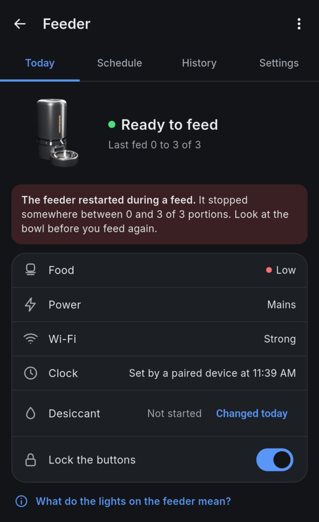
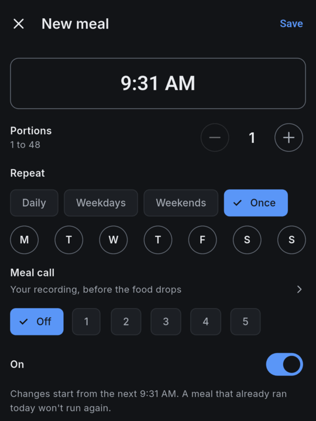
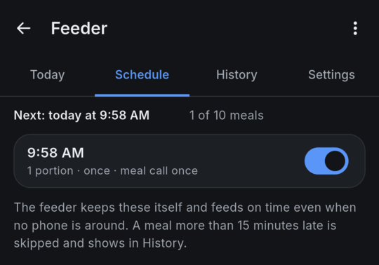
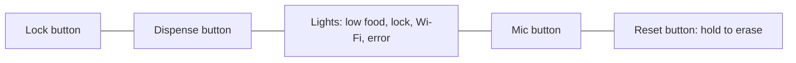
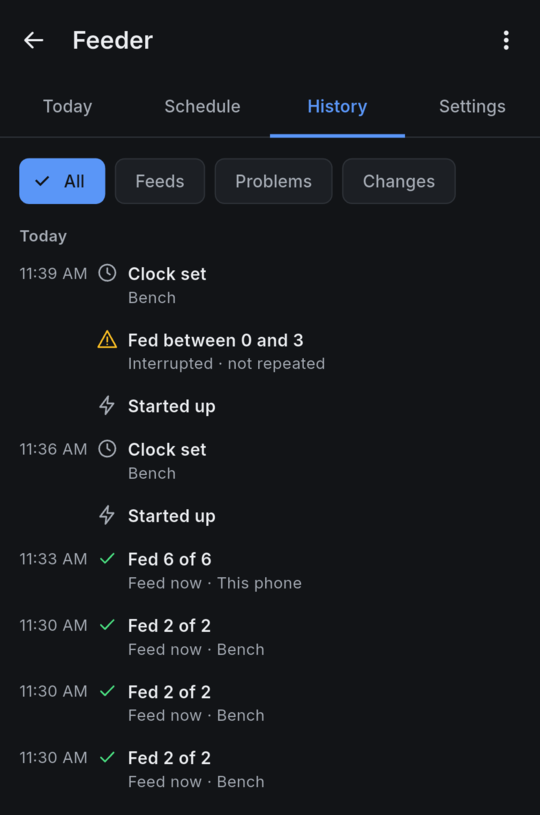

# Everyday use

This page covers life with a feeder running Wellfed: meals, feeding now, the buttons and lights, refilling and what happens when something is down. It is for owners, and each task starts with the app.

> [!NOTE]
> There's no public build to install yet, so this describes Wellfed as it runs on our test feeder. The [roadmap](../roadmap.md) shows how far along each piece is. Don't rely on it alone to feed a pet yet.

The app has one screen per feeder, with four tabs: **Today**, **Schedule**, **History** and **Settings**. Your phone has to be on the same network as the feeder, since the app talks to it directly.

The CLI keeps your key in `private/wellfed-owner.json` under the folder you run it from, and makes a new key if that file is missing. So run it from the folder you installed from, or pass `--keys`.



The screenshot shows Today after a power cut during a feed, which is why it has a red notice. The Feed now button sits below this crop.

## Meals

The feeder keeps up to ten meals and runs them itself, so no phone or server has to be around. Each meal has a time, 1 to 48 portions, and the days it repeats on. A meal set to run once stays in the list, switched off, after it has run.

<!-- tabs -->

### App

Open **Schedule** and tap **Add meal**. Set the time, the portions and how it repeats, then tap **Save**. Tap a meal to change or delete it, and use its switch to turn it off for a while.



### CLI

```sh
wellfed plans list
wellfed plans add --at 07:30 --portions 2 --days daily
wellfed plans edit 0 --days mon,wed,fri
wellfed plans disable 0
wellfed plans delete 0
```

A meal's number is its slot, as `wellfed plans list` shows it.

<!-- /tabs -->



A few rules are worth knowing:

- **A new meal starts from its next occurrence.** Saving a 07:30 meal at 07:35 feeds tomorrow, not now.
- **Moving a meal can feed it again the same day.** Changing a meal's time or days starts it afresh. Move a 07:30 meal that already ran to 12:00, and it feeds again at 12:00. The editor's note that a meal that ran won't run again holds only while the time stays put.
- **A late meal has 15 minutes.** If the feeder restarted or was busy, the meal still runs within 15 minutes of its time. Later than that, it doesn't run, and History shows **Meal skipped**.
- **Two people editing at once.** If the meals changed while you were editing, the change is refused and nothing is overwritten. Read them again and redo your edit. The CLI sees the same refusal as `Stale`.

### Before a meal

**Meal call** plays your own recording before a meal, up to five times, and ends as the meal is due. Uploading a recording takes an owner. In the app, it's a WAV file of about 8 seconds at most, chosen from the meal editor. On the CLI, it's `wellfed call upload dinner.wav`, then `wellfed plans edit 0 --call 2`. With sound off or outside its hours, the meal runs silently.

**Before each meal**, under Settings and Reminders, adds a **Meal coming** entry to History up to 60 minutes ahead. On the CLI, it's `wellfed settings --meal-reminder 10`. It's only a history entry: it plays nothing and sends no notification. Phone alerts are planned for the app, but they haven't been designed or built.

## Feeding now

<!-- tabs -->

### App

Tap **Feed now**, choose 1 to 48 portions and confirm. You can close the sheet, and the result shows on the feeder's card and in History. While it runs, **Stop feeding** asks the feeder to stop. What has already dropped stays in the bowl.

### CLI

```sh
wellfed feed --portions 2
```

It prints the feed's number and waits for the result. On a long feed, it can give up waiting after 2 minutes with an error while the feed carries on. Don't feed again: read `wellfed feeds` once it has had time to finish. To stop it, run `wellfed cancel-feed <feed>` from another terminal.

<!-- /tabs -->

A portion takes about 10 seconds. The feeder runs one feed at a time, and scheduled meals still run after a feed you start yourself.

If the app asks whether the feeder fed, or says **Fed between 0 and 3 portions**, the feeder can't say how much dropped. Look at the bowl before you feed again. The app and the CLI won't send that feed again, and neither will the feeder. [How feeding stays safe](how-it-works/feeding-safety.md) explains why.

## The buttons and lights



**The buttons start locked.** The panel locks at every boot and locks itself again after about 30 seconds with no presses. A locked panel ignores Dispense and the Reset hold. Scheduled meals and feeds from the app or the CLI aren't affected.

| To | Do this |
| --- | --- |
| Lock or unlock the buttons | Hold Lock for 5 seconds, or use **Lock the buttons** on Today, or `wellfed lock off` |
| Feed one portion | Press Dispense on an unlocked panel |
| Start Bluetooth setup | On an unlocked panel, hold Lock, then Mic, for 5 seconds. No feed runs during setup, which ends after 15 idle minutes, so an accidental hold can skip a meal. **Restart** in the app or `wellfed reboot` ends it sooner |
| Add this phone back when no phone can reach the feeder | On an unlocked panel, hold Lock, then Dispense, for 5 seconds. Then, within 2 minutes, choose **Recover a feeder** in the app or run `wellfed recover`, and key in the code it shows |
| Erase people, Wi-Fi, meals, settings and history | On an unlocked panel, hold Reset for 5 seconds |

> [!WARNING]
> Holding Reset wipes the feeder and draws a new identity. The backup of the vendor's firmware stays filed under the old identity, so the app no longer finds it for this feeder, and you'd need the copy you saved. If you didn't save one, keep the old feeder in the app's list: the app's settings should still offer its copy under **Firmware backups**. We haven't tried that rescue. Portion size and the record of past feed numbers are kept.
>
> The feeder then waits for Bluetooth setup, so choose **Add a feeder** on your phone.

| Light | Steady | Blinking |
| --- | --- | --- |
| Low food (red) | The food beam reads low | About once a second: a feed is running |
| Lock (white) | The buttons are locked | About twice a second: waiting for a pairing code |
| Wi-Fi (white) | The feeder has an address on your network | Once a second: Bluetooth setup. Quickly: installing an update |
| Warning (red) | A fault stopped feeding until a restart | Quickly, for 3 seconds: a press was refused. Every 2 seconds: batteries too low to feed |

Which states show is still provisional. With **Lights** off, or outside their hours, every light is dark, including the warning. **What do the lights on the feeder mean?** on Today has a short key. Where it differs from this page, this page is right.

## Refilling and the desiccant

Lift the lid and pour in dry food. You don't need to tell the app. On mains, the feeder reads the food beam about once a minute, so the low-food light clears within a minute or so. On batteries, it reads the beam only during a feed.

The food beam is a low warning, not a gauge. It sits above the rotor and reads low with about five portions left on our test feeder. A feed still runs when the food reads low, and tapping it in History shows the food level.

The desiccant reminder counts days from your last change, every 14 days until you change that. Settings has the period, from 1 to 90 days.

<!-- tabs -->

### App

Tap **Changed today** on Today or in Settings after you put in a fresh pack. Today shows the days left, or how many days overdue it is. The first time, the count begins when you tap.

### CLI

```sh
wellfed desiccant --reset
wellfed desiccant
wellfed settings --desiccant-days 21
```

<!-- /tabs -->

The feeder needs a set clock to record a change. It has no sound or notification for this: you see it on Today, or with `wellfed desiccant`.

## Weighing a portion

The feeder counts portions, not grams, and what a portion weighs depends on your food. One portion of the dry food we tried weighed about 7 g. The weight is only used for estimates, and it never changes how far the motor turns.

Feed one portion first and throw it away, so the rotor starts from a known place. Then feed 10 portions into an empty bowl and weigh them.

<!-- tabs -->

### App

This takes an owner. Open **Settings**, then **Time zone**, which opens **Clock and portion size**. Tap **I weighed 10 portions** and enter the grams.

### CLI

```sh
wellfed calibrate --weighed 71.1 --portions 10
```

<!-- /tabs -->

## History

**History** lists what happened, newest first: feeds, skipped meals, restarts, changes and who made them. Filter it with **Feeds**, **Problems** or **Changes**, and tap a feed for its detail. On the CLI, use `wellfed feeds` for the feeds and `wellfed events` for everything.



A feed that was interrupted reads as a range, such as **Fed between 0 and 3**, because the feeder can't know how far it got. **Fed 2 of 2** counts rotor marks. It doesn't mean the food reached the bowl, and the feeder never knows what your pet ate. "Bench" in this screenshot is the name of the client that made those requests.

The feeder keeps a limited history, and a long one needs the optional server. See the [roadmap](../roadmap.md).

## When something is down

Your feeder needs the time to run meals, and it has no battery-backed clock. "No internet" can still matter, since the default time source is the gateway on your network, usually your router.

| What's down | Scheduled meals | Feeding by hand |
| --- | --- | --- |
| Your phone, or the server | They run, unless the clock depends on that phone (below) | Dispense works. Feed now needs a phone or computer |
| The internet, with your router still on | They run if your router still answers with the time. A router that says its own clock isn't set is refused. How routers behave here varies, and we haven't tested it. To check yours, see whether **Clock** on Today reads **Set by your router** | Dispense and Feed now work |
| Your Wi-Fi or router | They run until the clock's possible error passes 2 minutes, then they hold. That limit counts from the last time the clock was fully set, not from the last poll, so it can come any time up to about 6.6 hours after the drop | Dispense works. Feed now needs Wi-Fi |
| Mains, with no batteries | Nothing runs while it's off. The clock is lost, so meals hold until it's set again | Dispense works once power is back |
| Mains, with batteries | They run while the clock stays good, then hold until mains returns and it's set again. Wi-Fi turns off after 5 seconds. Below the batteries' floor, no feed starts | Dispense works. Feed now doesn't work until mains returns |

"Dispense works" always means on an unlocked panel, and the panel is locked after a restart. While the feeder is trying to rejoin Wi-Fi, a press can be refused and the warning light flashes, and during an outage it keeps trying. Press again a little later. A meal is retried by itself within its 15 minutes.

After a power cut, your plans come back but the clock doesn't. If your router answers, the clock is set soon after the feeder rejoins Wi-Fi. Otherwise, open the app on the same Wi-Fi: it gives the feeder your phone's time when it connects to a feeder with no clock, and Today offers **Set the time from this phone**. On the CLI, run `wellfed time`.

When the time returns, a meal less than 15 minutes late runs, and an older one is skipped. On a day with a long outage, feed your pet another way.

Even with your router answering, the clock reads invalid for up to a minute about every 6.6 hours, until the next poll sets it again. A meal due in that minute runs once it's back.

A longer limit, about 22 hours, needs two `wellfed time` syncs from an owner about 11 hours apart. The feeder forgets that on every restart, the app doesn't do it, and we haven't checked it on the feeder.

An owner chooses where the time comes from, with **Get the time from** on the **Clock and portion size** screen: **Router**, **Address** or **Phones only**. An address has to be an IP address, since names aren't looked up. On the CLI, use `wellfed time --ntp gateway`, and `wellfed time --show` to see the clock.

**Phones only** needs something to set the clock at least every 6 hours or so, such as a timer that runs `wellfed time`. The app doesn't do this by itself: it sets the clock only once it's lost, when you open the app, and by then meals are already holding.

## People and invites

An owner can do everything. A member can feed, edit meals and settings, and lock the buttons. In the app, the Wi-Fi, time zone, people and firmware screens show only for an owner. A feeder lists up to eight phones, computers and keys in all.

<!-- tabs -->

### App

Open **Settings**, then **People**, and tap **Invite someone**. Choose **Member** or **Owner**, then show the code or share the link. On their phone, on the same Wi-Fi, they choose **Add a feeder**, then **Join with an invite**. Remove someone from the same screen, and their connection closes at once.

### CLI

```sh
wellfed invite --role member
wellfed join <invite>
wellfed clients
wellfed revoke <key>
```

<!-- /tabs -->

An invite works once and runs out after 10 minutes, or sooner if the feeder restarts. Treat it like a password until then. [Who can talk to your feeder](how-it-works/access.md) explains the rest.

## Updates

Nothing updates by itself, and there's no release to update to yet. In the app, an owner opens **Settings**, then **Firmware**. Today that offers only the build the app itself carries. The CLI has no update command.

A new build runs on trial, and if it doesn't start properly the feeder goes back to its other copy of Wellfed, which may be older. Feeding waits during the install. A meal due meanwhile runs afterward if it's within its 15 minutes, and otherwise it's skipped. [Install and rollback](how-it-works/install-and-rollback.md#when-an-update-goes-wrong) has the details.

## Next steps

- [How feeding stays safe](how-it-works/feeding-safety.md)
- [The system at a glance](how-it-works/system.md)
- [Going back to stock](going-back.md)

## Evidence

- **Observed, October 28 to 31, 2026.** Meals, feeding, the lock, the lights, the desiccant count, invites and every app screen here ran on one research feeder. A power cut mid-feed read as a range, as in the screenshots.
- **Observed, October 29, 2026.** One dry food weighed 7.11 g a portion, across two runs with a refill between them. Eight 1-portion feeds from a hopper near empty dropped 1.7, 11.4, 6.5, 7.0, 6.0, 3.0, 1.9 and 0 g while the food read low.
- **Observed, once, October 28, 2026.** A meal due with no clock after a cold boot held, and was recorded as missed when the time came back 16 minutes later.
- **Observed, October 28, 2026.** On batteries, Wi-Fi went off after 5 seconds and a Dispense press fed a portion on the same feeder. Twenty cycles of mains away and back each rejoined Wi-Fi. See [power](../firmware/power.md).
- **Modeled.** The clock's expiry after a long uptime and its drift learning haven't run on the feeder, and the battery floor has run only in simulation. See [clock](../firmware/clock.md) and [power](../firmware/power.md).
- The screenshots are from an October 31 run. They're cropped, and nothing in them needed painting over.
