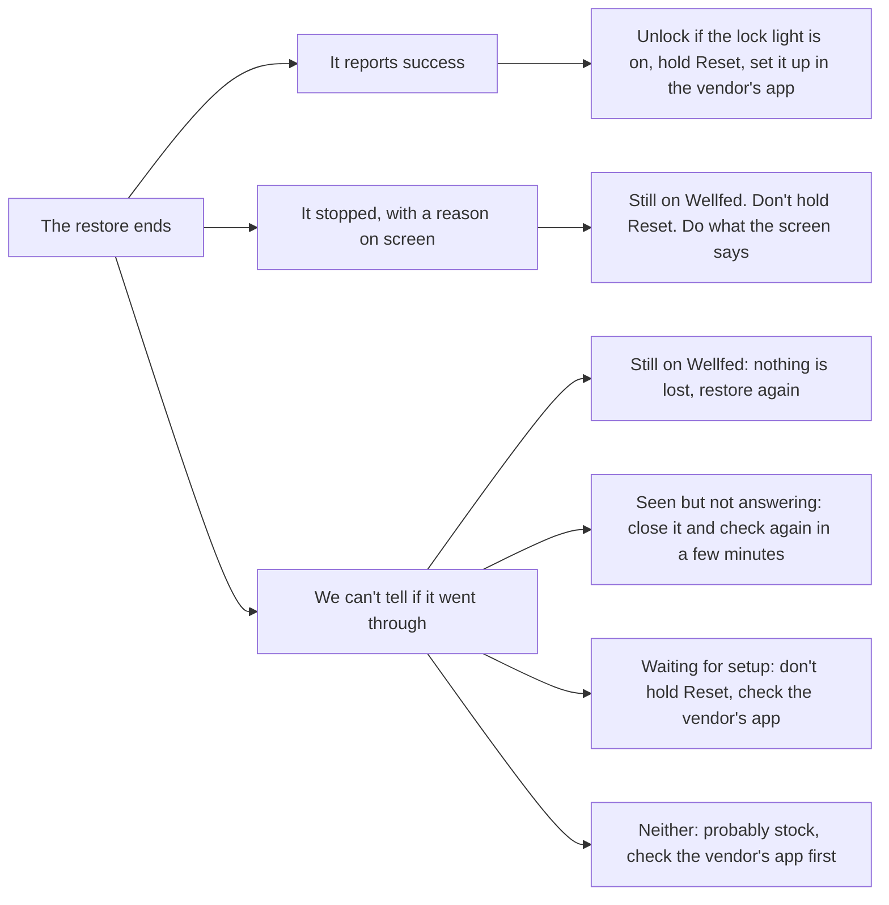

# Going back to stock

This page walks through putting the vendor's firmware back on a feeder running Wellfed, then setting it up in the vendor's app. It is for owners. It needs the backup the install made, and the phone or computer that owns the feeder.

> [!NOTE]
> There's no public build of Wellfed yet, so nobody can follow this outside our bench. It shows what the return involves, on the one feeder we've tested.

> [!WARNING]
> **Don't start by holding Reset.** That's the last step, and only after a restore reports success. On a feeder still running Wellfed, the hold wipes it and draws a new identity, and the phone's backup stays filed under the old one. You'd then need the copy you saved. If you didn't save one, keep the old feeder in the app's list: the app's settings should still offer its copy under **Firmware backups**. We haven't tried that rescue.

## Before you start

- **The owner's phone or computer.** A member can't do this. It has to be on the same Wi-Fi as the feeder. If you've lost it, the [recovery hold](everyday-use.md#the-buttons-and-lights) makes a new phone the owner without erasing anything, and **Pick the file** can then use your saved copy. We haven't run that route.
- **Mains power.** A feeder on batteries refuses the update.
- **Your meals noted down.** Meals, people and history in Wellfed don't carry over.
- **An idle feeder.** Don't start during a feed or an update.
- **The backup, checked.** The next step shows you.

## Step 1: Check the backup

<!-- tabs -->

### App

Open the feeder, then **Settings**, **Firmware** and **Restore original firmware**. You should see the backup's date, **Vendor 1.1.15**, and **Matches the original**.

If it says **No backup on this phone**, tap **Pick the file** and choose the copy you saved. A file that doesn't match the vendor's 1.1.15 exactly is refused, and nothing is sent.

### CLI

```sh
wellfed backup show
```

Run this from the folder you installed from, or pass `--keys` and `--backups`. Run from anywhere else, it makes a new key and finds no backup, which doesn't mean the backup is gone.

You should see `stock_version` 1.1.15 and `verified` true. To use a copy you saved, add `--backup <file>` in the next step. A file that doesn't match the pinned image exactly is refused.

<!-- /tabs -->

## Step 2: Start the restore

<!-- tabs -->

### App

Read the two warnings, tick **I understand** and tap **Restore original firmware**.

### CLI

```sh
wellfed restore-stock
```

<!-- /tabs -->

## Step 3: Press Dispense once

Wait until the app or the run asks. Then press Dispense on the feeder, once, within 60 seconds. This shows someone is at the feeder, and it approves a temporary key that signs this one restore.

The press works whether or not the buttons are locked, and it feeds nothing. A press before the prompt doesn't count: on an unlocked panel, it starts a feed.

## Step 4: Wait for it

The firmware goes across and the feeder restarts. Keep the feeder plugged in and your phone or computer on the same Wi-Fi. Once sending has started, you can't stop it from the app.

The run ends in one of three ways:



## Step 5: Set it up in the vendor's app

Do this only once the restore has reported success: the app says **The original firmware is going back**, or the CLI says `Activated`.

The vendor's firmware now runs, and it keeps trying to reach your phone or computer, forever. Wellfed can't talk to it any more.

1. If the lock light is on, hold Lock for 5 seconds. The app's final screen doesn't mention this, but a locked panel ignores the Reset hold.
2. Within about 30 seconds, since the panel locks again, hold Reset for about 5 seconds. You should see the feeder restart and open its setup network.
3. Set it up in the vendor's app.

If the panel ignores the hold, the vendor's app may have disabled the buttons. Hold Lock for about 3 seconds, then Reset for about 3 seconds.

**Keep your backup.** You can use it again if you ever return. In the app, the feeder stays in your list until you choose **Remove from this phone** in its settings. Share the backup somewhere safe first: once the feeder is removed, the app no longer lists its copy.

**A vendor update can close the way back.** The install expects the vendor's 1.1.15. If the vendor's app updates the feeder, installing Wellfed again may not work. We haven't tried it, and we don't know whether that app updates by itself.

**Wellfed's storage stays on the feeder.** Going back doesn't erase it, and the vendor's firmware doesn't read it. Your Wi-Fi password and the feeder's identity key stay unencrypted on the flash chip until Wellfed next starts. Before you pass the feeder on, change that Wi-Fi password.

## If it stops, or you can't tell

Nothing here sends the restore again by itself. If the feeder stops answering once the firmware has started going across, the result is uncertain, since the vendor's firmware doesn't answer Wellfed's questions. The app then looks for the feeder on your Wi-Fi and over Bluetooth, and tells you what it found. The app uses your feeder's name where this table says Feeder. These are the stops you're most likely to see. For any other, follow the screen.

| The app says | What it means | What to do |
| --- | --- | --- |
| **Dispense was not pressed in time** | Nothing was sent | Try again |
| **That isn't the original firmware** | Nothing was sent | Find a good copy. Without one, we have no way back to stock to offer you: our UART tools are pinned to our one test feeder, and they need a stock image you'd already have to hold |
| **Only the owner can do this** | Nothing was sent | Use the owner's phone or computer |
| **Feeder wouldn't take the press** | Nothing was sent. It may be busy, or its list of phones and keys may be full | Try again. If it keeps happening, remove any old **Update key** on the People screen |
| **Feeder said no** | It stays on Wellfed, and the vendor's copy may be partly written | Unplug the feeder and take out any batteries for a few seconds, then start a new restore |
| **Feeder is still running Wellfed** | The restore didn't finish, and nothing is lost | Tap **Restore again** and press Dispense once more |
| **We still can't tell** | It showed up on your Wi-Fi but never answered as idle | Close it, then check again in a few minutes, here or in the vendor's app |
| **A feeder nearby is waiting to be set up** | Probably this one, with Wellfed's Wi-Fi, phones and meals already cleared, and the restore unfinished. It could also be another feeder of yours | **Don't hold Reset.** Check the vendor's app first. If it isn't there, tap **Set it up**. Your backup is still good, so you can restore from there |
| **It's probably on the original firmware** | It answered on neither Wi-Fi nor Bluetooth | Check the vendor's app. If it can't find the feeder and you're sure it isn't on Wellfed, unlock the panel if the lock light is on, hold Reset for about 5 seconds and set it up there |

On the CLI, a stop or an uncertain end prints what it knows. If it's uncertain, look for the feeder first. If a session opens, Wellfed still runs, and `wellfed restore-stock` may go again. If it advertises Bluetooth setup, run `wellfed setup`, and don't hold Reset. Only if neither shows after a few minutes is it probably on stock.

> [!WARNING]
> The restored firmware doesn't run on trial. If it's valid but won't boot, nothing falls back to Wellfed, and only [UART recovery](../devices/plaf103/recovery.md) could bring the feeder back. Those tools are pinned to our one test feeder, so don't count on them for yours. Nothing here protects against it.

An interrupted restore can leave Wellfed running with its Wi-Fi, phones and meals already cleared. That feeder runs no meals until it's set up again, so feed your pet another way.

## Common mistakes

- **Holding Reset to "retry".** See the warning at the top.
- **Pressing Dispense early.** Wait for the prompt. If the window runs out, nothing was sent.
- **A leftover update key.** After a restore that stopped, you may see an **Update key** on the People screen. It signs nothing more, but it takes one of the eight places until an owner removes it.

## Next steps

- [Install and rollback](how-it-works/install-and-rollback.md#going-back-to-the-vendors-firmware) explains how the restore travels through the banks.
- [Install](install.md) covers coming back to Wellfed, which starts over like a first install.

## Evidence

- **Observed, October 30 and 31, 2026.** The restore ran on one research feeder from the app, from both banks, and from the CLI. After one restore, the install ran again at the same version.
- **Observed, once, October 31, 2026.** Setup in the vendor's app completed after a restore, with the vendor's firmware on the vendor's cloud.
- **Recovered.** That the loader doesn't fall back from a valid stock that won't boot comes from analysis of the boot path, not from a test. The Lock and Reset sequence for disabled buttons comes from analysis of the vendor's firmware, and hasn't been pressed on the feeder.
- **Static analysis.** What stays in Wellfed's storage comes from the design and code. Nobody has read a chip back after a restore.
- **Modeled.** The app's screens for a stop or an uncertain end are covered by host tests, and not every one has happened on the feeder. We have no record of **Pick the file** or `--backup` running on the feeder.
