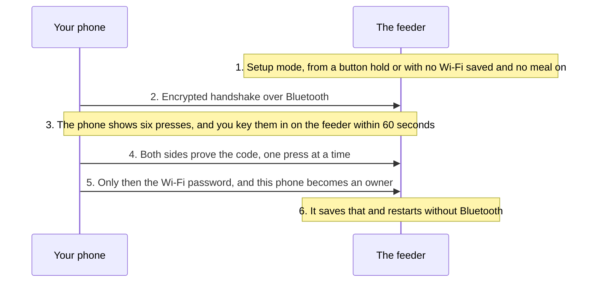
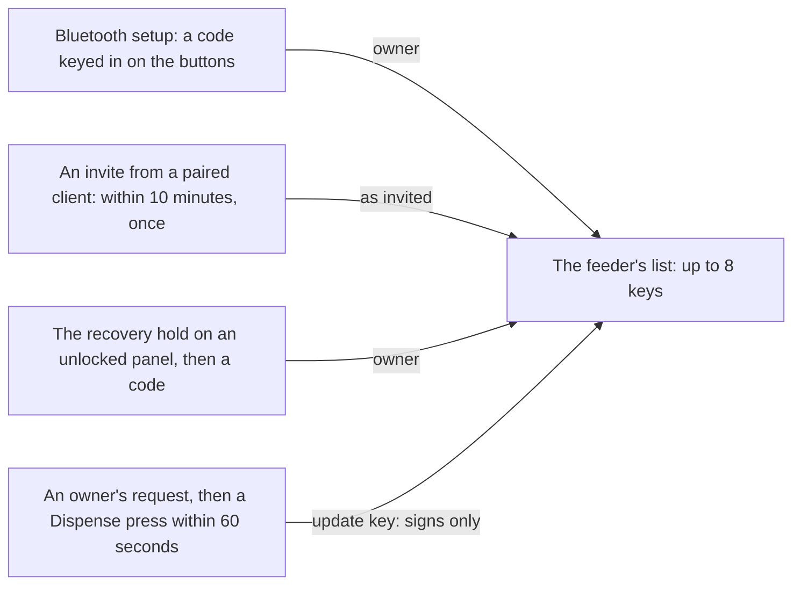
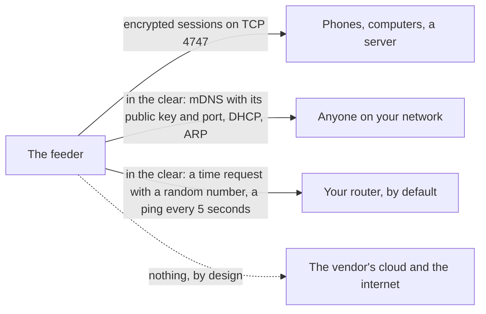

# Who can talk to your feeder

This page explains who may connect to a feeder running Wellfed, how they get in, what crosses your network, and what isn't protected. It is for owners who want to judge the risk. It describes the design and what ran on our one test feeder.

## The one idea

Every phone or computer has its own key, and the feeder keeps a short list of the keys it trusts. Getting onto that list always takes someone at the feeder, or a client already on it. Nothing arriving over the network alone can make a stranger an owner.

There's no cloud and no account. The feeder doesn't sign in anywhere, and every session is encrypted with the [Noise protocol](https://noiseprotocol.org/), so a neighbor on your network sees only scrambled traffic.

## Becoming the first owner

Follow one phone from a fresh feeder to an owner. Bluetooth is off unless you turn it on with a button hold, or the feeder has no Wi-Fi saved and no meal enabled. A saved network that's down doesn't turn it on.

Why a code you press, rather than a single button? The handshake alone trusts whichever device answers. A device in radio range could sit between your phone and the feeder, and pass messages both ways. The feeder has no screen to compare numbers on, so you carry a secret the other way: from the phone's screen to the feeder's buttons.

Both sides then prove they saw the same code, tied to their own handshake. A relay has a different handshake on each side, so it has to guess the presses. Its odds are 1 in 1,024 of fooling the phone, and 1 in 4,096 of getting enrolled, each time you key in a code. The phone sends your Wi-Fi password only after that proof, so a relay that fails doesn't get it.

Bluetooth setup can only pair and set Wi-Fi. It can't feed or change anything else. Setup mode ends with a restart, when it finishes or after 15 minutes without a session.

## The ways in

- **Bluetooth setup** is above. You start it on a running feeder by holding Lock, then Mic, for 5 seconds on an unlocked panel.
- **An invite** comes from a paired client, as a code or a link. An owner can invite an owner, a member or a server. A member can invite members, from the CLI only, since the app shows **People** only to owners. It works once, and within 10 minutes. A restart cancels it. The person redeeming it has to be on the same network as the feeder.
- **The recovery hold** is the way back in when every client is lost. Holding Lock, then Dispense, for 5 seconds on an unlocked panel opens a window of 2 minutes, and a client then proves a code you key in. It doesn't erase anything.
- **An update key** can sign firmware and never opens a session. An owner asks, and you press Dispense to approve. The restore to stock uses a temporary one. The project's release key can sign firmware too, but only an owner can offer an update to the feeder.

You can lock the buttons and still answer a pairing: the presses for a code, and an approving Dispense, count whatever the lock says. They don't feed.

## Who can do what

| Role | Can | Can't |
| --- | --- | --- |
| Owner | Everything, including Wi-Fi, updates, restart, and removing people | |
| Member | Feed, edit meals and settings, lock the buttons, and invite members | Change Wi-Fi or time settings, restart, remove people, install updates, enroll update keys, calibrate, upload or delete the meal call, read logs, or read the backup |
| Server | The same as a member, except inviting | The same as a member, and invite anyone |
| Update key | Sign firmware, once an owner has enrolled it | Open a session |

So the server has the owner's powers only if you adopt it with an owner's invite. That's the supported setup, since it's the only one where every route works, so expect a normal server to hold full authority. Treat its data directory like your own key. Removing someone closes their connection at once. It doesn't remove what they did from History.

## What crosses your network

Sessions carry meals, settings, history and Wi-Fi changes, all encrypted. Each side proves its key, so a stranger can't read or write anything, and a client can tell it reached the right feeder.

Some things aren't encrypted, because they can't be. The feeder announces itself over mDNS, including its public key and port, so that clients can find it. That key isn't a secret, and finding the feeder grants nothing. Time requests carry only a random number, and the answers aren't authenticated. The feeder also does what any device on a network does, with DHCP and ARP, and pings your router every 5 seconds to check the link.

**What never leaves.** The feeder talks to your network, not the internet. It has no cloud client and no way to download firmware by itself, and everything it stores stays on it, or goes to clients you've let in. Your phone's own traffic is separate: the app keeps its data on the phone. The exception is a time server, if you choose a public address for it. Then its requests go out through your router.

**During the install,** the vendor's firmware is still in charge. Your Wi-Fi password goes unencrypted over the feeder's open setup network for a few seconds. [Before you start](../before-you-start.md#what-can-go-wrong) has that risk.

## What this doesn't protect against

- **Someone holding the feeder.** The identity key and the Wi-Fi password sit unencrypted on the flash chip, since the board has no secure element. Anyone who opens the feeder and reads the chip can pose as it until its next reset. Anyone at the panel can also unlock it with a 5-second hold, then wipe it or use the recovery hold. **The lock is a child lock, not security.**
- **A phone or computer you've lost.** An owner's phone can do everything an owner can, from your network, until it's removed. On Android the key lives in secure storage, and the app itself has no passcode. The CLI's key is a plain file, so protect it. If it was the only owner, use the recovery hold.
- **A leaked invite.** Until it's used or expires, whoever holds an invite and can reach the feeder's network can join with its role. Share it with care, and check **People** afterward.
- **Someone on your network, for reliability.** They can't read or send commands, but we don't claim the feeder stands up to a determined flood. They can also see that a feeder exists, and when it's busy. Spoofed time answers can move the clock within its error bound, or set it freely when it has no valid time, which can shift meals. [Clock](../../firmware/clock.md#the-clock) spells that out.
- **A Bluetooth relay that guesses right.** The odds above apply each time you key in a code. A deliberately mistyped code hasn't been tried on the feeder, only in host tests.
- **Your own devices.** Malware on an owner's phone or computer can do anything that owner can.
- **An outside review.** No one outside the project has audited this.

## Evidence

- **Observed, October 24, 2026.** Bluetooth setup with the code, recovery over the network with a code, a locked panel refusing the recovery hold, an invite's redemption and a revocation ran on one research feeder.
- **Observed, October 30, 2026.** A feeder fresh from the vendor's firmware started setup mode by itself, and both the app and the CLI paired through it.
- **Modeled, October 24 to 29, 2026.** A relay between two handshakes, a wrong code, a wrong or missing invite secret and a store cut at every write ran in host tests. The Noise handshakes were checked byte for byte against the `snow` library.
- **Static analysis.** That the feeder has no cloud client comes from its design and code. We haven't captured a long run of its traffic for this page. [Pairing](../../firmware/pairing.md) and [Bluetooth](../../firmware/bluetooth.md) hold the record.
