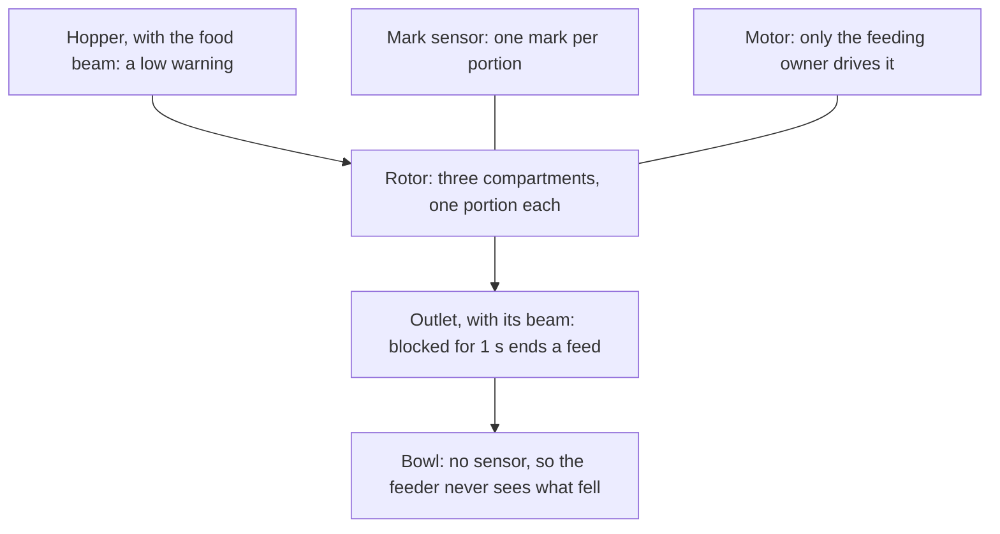
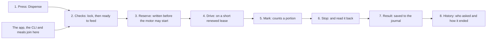
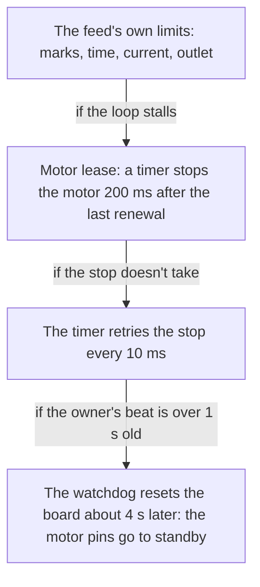
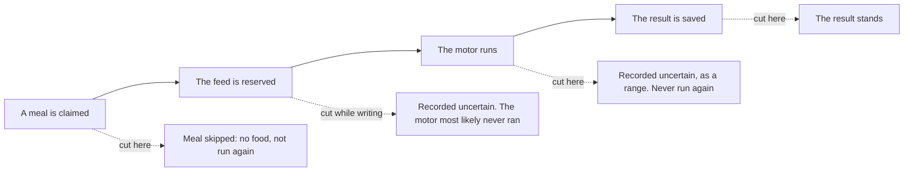

# How feeding stays safe

This page follows one feed from a button press to the history, and explains what stops the motor, why a power cut can't make a feed run twice, and where those guarantees end. It is for owners who want to judge the risk. Everything here ran on one test feeder or in simulation, and the Evidence section says which.

## The one idea

Only one piece of firmware, the feeding owner, may move the motor, and every feed goes through it. It writes a feed down before the motor may start. If it later can't say how a feed ended, it records that it doesn't know, and it never runs that feed again.

So the feeder prefers a short meal to a double one. A feed is **at most once**, not exactly once. A power cut in the wrong moment can leave a meal unfed, and a person still has to look at the bowl.

## Inside the feeder

*Schematic, not to scale.*

## One feed, start to finish

Say you press Dispense on an unlocked panel. The same path serves the app, the CLI and a scheduled meal.

1. **The press.** A small button task only queues the press. It goes to the feeder's one main loop, which also handles network requests. So a press and two phones reach the same owner, one at a time.
2. **The checks.** A locked panel ignores the press. Then one question decides: can a feed start now? Not during another feed, a Wi-Fi join, a flash write, an update, Bluetooth setup, a restart or a fault. A refused press isn't queued, and the warning light flashes.
3. **The reservation.** The feed journal, a small record on flash, saves this feed's number before the motor may start. Everything that follows rests on this.
4. **The drive.** The motor turns the rotor under a lease of 200 ms that the owner has to keep renewing. Before it starts, a blocked outlet, low power or an unreadable beam ends the feed with that reason and no motion.
5. **The mark.** A sensor sees a mark on the rotor once per compartment, about every 10 seconds with food. One mark is one portion. That's how the feeder counts, and it's all it can count.
6. **The stop.** The motor stops about 20 ms after the last mark. The feeder reads the stopped state back before it trusts it.
7. **The result.** Only then does the result go to the journal, with what was asked, what was counted and why it ended.
8. **The history.** The result becomes a `Fed` event, which the app shows in History as **The Dispense button** having asked. The owner then takes the next feed.

## What stops a feed

The feed's own limits end most problems, each with a name in the history. Behind them sit stops that don't depend on the main loop working.

| What goes wrong | How the feeder sees it | How the feed ends |
| --- | --- | --- |
| A jam | Motor current held over the limit | It backs off 1 s and drives on, at most three times, then ends `jammed` with what it counted |
| A very high current | One reading over the ceiling | It stops at once, `overcurrent`, with no reversal |
| The marks stop | No mark edge for 11 s, or no portion in 15 s | It ends with no feedback, and doesn't reverse, since it can't tell a jam from a lost sensor |
| The mark sensor sticks | Low for 4 s | It ends `mark_stuck` |
| A blocked outlet | The beam is blocked for 1 s | It stops at once, and clearing the outlet doesn't resume it |
| A feed that runs long | 12 s a portion, capped at 48 portions' worth | It ends on its deadline |
| Lost sensors | A reading never completes | It ends `sensor`. The feeder then holds, with meals stopped, until a restart. Once a power cycle, after 10 minutes at rest, it tries one restart by itself |

If the main loop itself stalls, or a stop doesn't take, these stops take over. We tested each by injecting the fault during real motion, with an empty hopper.

A jam and a failed feed don't stop the feeder from feeding again. The app says what happened and asks you to look at the bowl. Only a held fault stops feeding until a restart.

## Why a power cut can't feed twice

The reservation goes on flash before the motor may start, and the result goes on flash after it stops. So a boot that finds a reservation with no result knows a feed was cut. It records that feed as uncertain, under its own number, and moves on to the next number. Neither the firmware nor the clients resend it.

A scheduled meal adds a step in front. It first saves a claim on that day's meal, so a restart or a clock moved backward can't run it again. A cut between the claim and the reservation costs that meal: it's recorded as skipped, and it doesn't feed.

The limits of that promise matter:

- **It's about one feed, not the pet's day.** An uncertain feed may have dropped anything from none to all of its portions. The next scheduled meal runs as usual, so a pet can eat both.
- **The rotor stays where it stopped.** The next feed turns to the next mark first, and that may drop a part-emptied compartment. By the timing, that's at most about 55 % of a portion more than it counts, or about 45 % less when the first compartment it counts was already part-emptied. One test dropped nothing extra, and we haven't measured it widely.
- **A person can still feed again.** The app asks you to look at the bowl, and then starts a new feed if you ask.
- **Flash can fail.** A bit flip in a saved result can make a boot record an extra uncertain entry for that number. It doesn't feed.

## Uncertain is an answer

When an answer is lost, no client resends a feed. If your phone loses the connection after sending, the app asks whether the feeder fed and tells you to look at the bowl. If the feeder stayed on, it finishes by itself and keeps the result in its history. The CLI does the same, and `wellfed feeds` reads the result later. The CLI can also stop waiting on a long feed after 2 minutes, while the feed carries on, so an error there doesn't mean the feed failed.

A refusal is different, because nothing moved. The app offers **Start over**, which is a new feed you ask for.

## Low food and empty hoppers

The feeder doesn't refuse a feed for low food, so a beam stuck on "no food" doesn't hold meals back. The cost is that it can't tell you the food arrived. The food beam reads low with about five portions left on our test feeder, and it only says present or low.

The motor turning past a mark counts as a portion whether or not food fell. In one test on a nearly empty hopper, eight 1-portion feeds dropped 1.7, 11.4, 6.5, 7.0, 6.0, 3.0, 1.9 and 0 g, against a usual 7 g. So a portion can also run well over. Tap a feed in History to see whether the food read low, and treat that as your warning.

## Meals with no server

The plans and their marks live on the feeder. It works out each meal once a minute and runs it itself, so no phone, server or internet is involved. It does need the clock. With no valid clock, it holds meals rather than guess.

Once time returns, a meal up to 15 minutes late runs once, and a later one is recorded as skipped. A backward clock jump or a restart doesn't repeat one. [The system at a glance](system.md#what-keeps-working) follows what happens during an outage.

## What this doesn't protect against

- **A pet going hungry.** Meals can be skipped by a long outage, a power cut, a fault or an empty hopper, and no alert reaches you. Alerts are planned for the app, but they haven't been designed or built.
- **A real jam.** Kibble pressed into the rotor by hand didn't jam it, so the jam handling has run only on simulated current readings. Whether 1 second of reversing frees a real jam is unknown. The current limits come from empty and lightly filled drives, and a full hopper or batteries haven't been measured.
- **Food stuck above the rotor.** Food bridging in the hopper still counts as portions.
- **A stuck-clear outlet beam.** The feeder doesn't check that the beam really responds, so a blocked outlet could read as clear. A jam would still end the drive.
- **A bug past the supervision.** These stops bound how long the motor runs. They don't check that a meal's time or size is what you meant.
- **Motion after a reset.** On one captured reset, the motor leads showed three short flickers within 0.2 ms, one in the opposite direction. No drive followed, and it's not fully explained.
- **A different feeder.** The limits and timings come from one feeder and a few foods.

Don't rely on Wellfed alone to feed a pet yet.

## Evidence

- **Observed, October 25 and 26, 2026.** A power cut mid-feed on the research feeder resolved as uncertain at the next boot and was not re-run.
- **Observed, October 26, 2026, hopper empty, once per case.** Injected stalls ended the drive by the lease 0.18 to 0.2 s later. A failed stop held 300 ms ended at the first retry. One held 8 s ended at the watchdog reset, after about 7 s of drive.
- **Observed, October 26 to 28, 2026, hopper empty.** Injected jams, lost marks, a stuck mark and a lost sensor each ended as named, with every feed stopped and recorded.
- **Observed, October 29, 2026.** A beam taped before a feed ended it with no drive. Covered mid-feed, the motor stopped 1.0 s later. Hand-pressed kibble didn't jam the rotor. Feeds from a near-empty hopper dropped as described above.
- **Observed, October 28, 2026, hopper empty.** A daily plan fed once, and a reboot within its minute ran nothing again.
- **Modeled, October 26 to 28, 2026.** Cuts between a claim and its feed, and through each journal write, ran in simulation and host tests. Every jam position was swept in simulation. [Motor and feeds](../../firmware/motor-pulse.md#evidence), [jams and sensor faults](../../firmware/jams-and-sensor-faults.md#evidence) and [schedules](../../firmware/schedules.md#evidence) hold the record.
