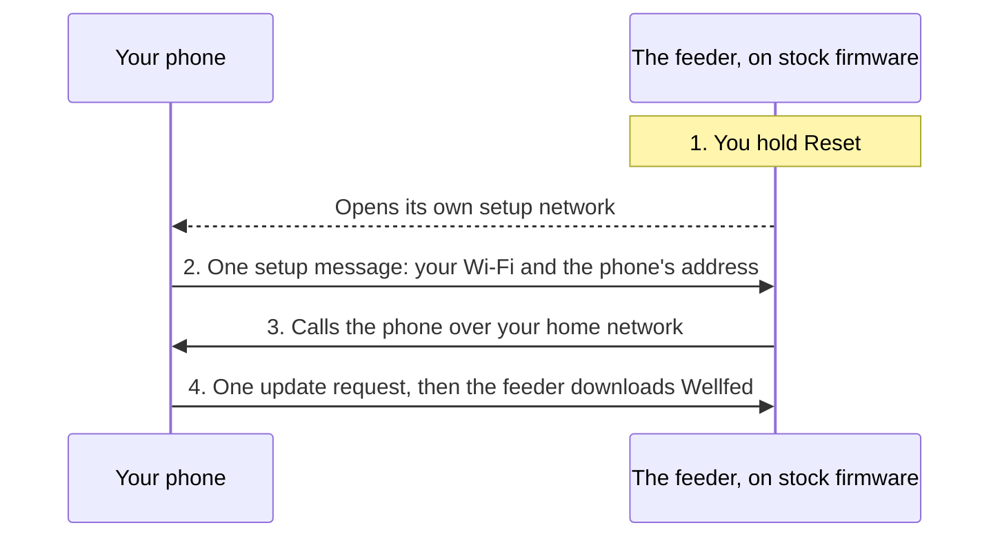
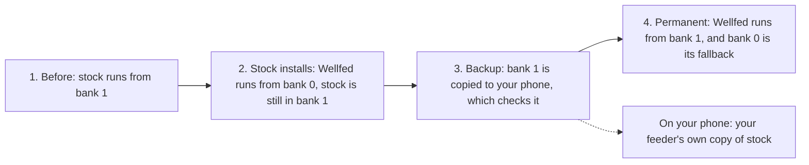
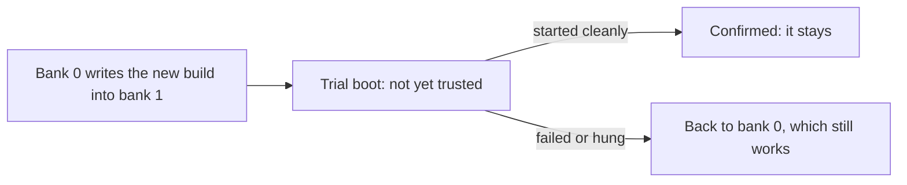

# Install and rollback

This page explains how Wellfed gets onto a feeder with no soldering, how the install guards your only copy of the vendor's firmware, and what happens when an update goes wrong. It is for owners who want to judge the risk. For the steps themselves, see [Install](../install.md).

## The one idea

The feeder already knows how to update itself, and it will install an image from whichever server it trusts. So the installer doesn't break in. It becomes that server for a few minutes, asks for one update, and lets the vendor's own updater do the work.

## Getting the feeder to listen

Normally the feeder talks to the vendor's cloud. Holding Reset puts it back into the state it ships in, waiting to be told about a network and a server. Your phone answers that question with your Wi-Fi and its own address.

The phone asks exactly once. A refused request can damage the updater's records on the feeder, and a request that gets no answer may still be downloading, so asking again isn't safe. If the outcome is unknown, the installer stops and waits for the feeder to report what happened.

## Two banks, and why that matters

The feeder's flash has room for two firmware images, called bank 0 and bank 1. It boots bank 1 if bank 1 is valid, and bank 0 only if it isn't. An update never overwrites the firmware that's running.

That rule is what the install relies on, and it happens in stages. These are the stages on the one feeder we've tested, which runs the vendor's firmware from bank 1:

Stage 3 is the safeguard. The installer refuses to go on to stage 4 until it holds a copy of bank 1 that matches a known hash of the vendor's 1.1.15 firmware. If the copy doesn't match, the run stops, and bank 1 still holds the vendor's firmware. **On this route, the feeder's copy of stock isn't overwritten until you hold a good one.**

That doesn't mean the feeder could simply go back at stage 3. Stage 2 already changed a marker on bank 1, so the vendor's firmware won't start again until it's restored from a good copy. If your feeder's bytes never match, the feeder stays on Wellfed in bank 0, and only UART gets back to the vendor's firmware.

The copy normally comes from your own feeder, which is why we don't need to distribute the vendor's firmware.

## When an update goes wrong

Once Wellfed is permanent, every later update follows the same rule. Bank 1 gives way to bank 0, and bank 0 writes the new build into bank 1. The new build then runs on trial.

A build confirms itself only after it has started cleanly. If it keeps failing or hangs, the feeder goes back to bank 0 by itself, with no action from you. [Bank policy](../../firmware/bank-policy.md) has the details.

## Going back to the vendor's firmware

You send the backup back as a signed update from the phone or computer that owns the feeder, on the same Wi-Fi. It's written through bank 0 like any other update. You press Dispense on the feeder first, to approve the key that signs it.

The vendor's firmware then runs, and it keeps trying to reach the server it knew. Once it's running, unlock the panel if the lock light is on, hold Reset for about 5 seconds, and set the feeder up in the vendor's app.

> [!WARNING]
> Only hold Reset once the restore has reported success. On Wellfed, that hold wipes the feeder and draws a new identity, and the phone's backup stays filed under the old one.

## What this doesn't protect against

- **A bug that doesn't stop Wellfed starting.** A build can pass its trial and still misbehave later. Feeding has its own supervision, but this page's safeguards are about booting.
- **Both banks going bad.** With neither bank valid, the feeder waits forever, and only [UART recovery](../../devices/plaf103/recovery.md) brings it back. A broken low-level core or factory configuration needs UART too. We've built the update path so that this shouldn't happen.
- **A first boot that fails.** Between stages 2 and 4 there's no working second bank to fall back to, since the vendor's firmware can't start.
- **A restore that goes wrong.** The vendor's firmware doesn't run on trial, so if it's valid but won't boot, nothing falls back and only UART recovers it. A restore that's interrupted can leave Wellfed with its Wi-Fi, phones and meals already cleared.
- **Losing your backup.** After the install, the feeder holds no copy of the vendor's firmware. Uninstalling the app or clearing its data deletes the app's copy, so save one elsewhere.
- **A feeder laid out differently.** A feeder running the vendor's firmware from bank 0, perhaps after a vendor update, hasn't been tried. Don't assume these stages apply to it.
- **A different feeder.** All of this was checked on one feeder, on one firmware version.

## Evidence

- **Observed, October 29 to 31, 2026.** The install, the backup, the promotion and the return to stock ran on one research feeder, from the app and the CLI. The backup's bytes were checked against the pinned hash.
- **Recovered.** That a refused request can erase the updater's status comes from analysis of the vendor's firmware, not from a test on a feeder.
- **Observed.** A build that fails to start or hangs gave way to the previous one on the same feeder. [Consumer installation](../../firmware/consumer-installation.md#evidence) and [the OTA design](../../firmware/ota-design.md) hold the record.
