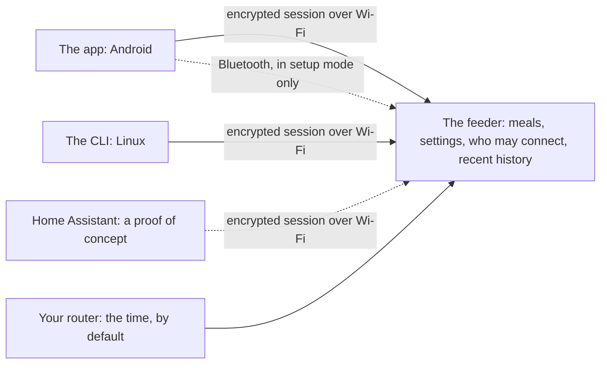
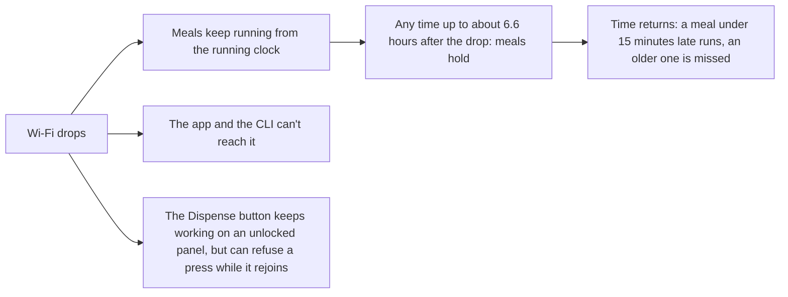
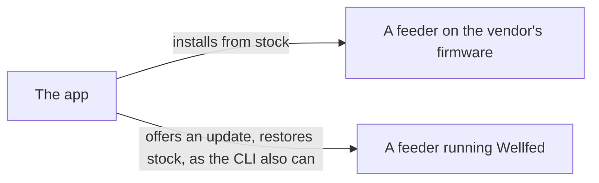

# The system at a glance

This page explains what the feeder, the app, Home Assistant and the CLI each do, and what keeps working when one of them is down. It is for owners deciding how much to run. For what's finished, see the [roadmap](../../roadmap.md).

## The one idea

The feeder owns its own state. Meals, settings, who may connect and recent history all live on the feeder, and the feeder decides when to feed. Everything else is a client that asks it, so losing a client loses that client's features, not your meals.

## The parts

| Part | What it does | What it doesn't do |
| --- | --- | --- |
| The feeder | Runs meals by itself, drives the motor, checks every request, and keeps its plans and recent history | Talk to a cloud. It never downloads anything from the internet: an update has to be offered by a client |
| The app | A screen for each thing the feeder offers, on Android: install, setup, meals, history, settings, people, updates and going back. It notifies the feeder's alerts while you're home | Hold any meals or feeding logic of its own, or decide an alert: it shows what the feeder reports |
| The CLI | The same actions from a Linux computer, with text for people and JSON for scripts | Run as a service. It's one command at a time |
| Home Assistant | The feeder's meals, feeds, settings and alerts as Home Assistant entities, for automations and dashboards | Install firmware, change Wi-Fi or remove clients: those stay with the owner's phone and computer |

The app, Home Assistant and the CLI share their protocol code in Rust, so they can't disagree about what goes over the wire. Each phone or computer has its own key, and a feeder lists up to eight. [Who can talk to your feeder](access.md) covers those keys.

## Following one meal

Say you add a 07:30 meal from your phone.

1. The app sends the change over its encrypted session, naming the version of the meals it read. If someone else changed them meanwhile, the feeder refuses it and nothing is overwritten.
2. The feeder saves the meal to its own flash. From here the phone doesn't matter: you can turn it off.
3. The feeder polls your router for the time about every 17 minutes, by default.
4. At 07:30 the feeder starts the feed itself, through the same code as a Dispense press.
5. The result goes into the feeder's own history. The app reads it the next time it connects, and so does Home Assistant.

The feeder depends on two things in that list: the clock and its own flash. It doesn't need the phone, the CLI, Home Assistant or the internet, as long as something on your network keeps the clock set.

## What keeps working

The clock is the catch. The feeder has no battery-backed clock, and it keeps track of how far off it could be. Once that passes 2 minutes, the clock reads invalid and scheduled meals hold, rather than guess. That limit counts from the last time the clock was fully set, not from the last poll, so after Wi-Fi drops it can come any time up to about 6.6 hours later. That's with the time from your router, which never teaches the feeder how fast its clock drifts; once your own syncs have taught it, the window grows to about a week ([clock](../../firmware/clock.md#the-clock)). Dispense still feeds on an unlocked panel, though a press can be refused while the feeder tries to rejoin.

| When this is down | Meals | The app and CLI, directly | What you lose |
| --- | --- | --- | --- |
| The internet | Keep running if your router still answers with the time | Keep working, on your network | The clock, if your router stops answering or says its own clock isn't set. We haven't tested how routers behave here |
| Your router or Wi-Fi | Keep running until the clock's error passes 2 minutes, then hold | Can't reach the feeder | Everything over the network, until it's back |
| Your phone | Keep running | The other clients still work | Nothing, unless your phone was the clock's only source |
| Mains, no batteries | Don't run, and hold after it's back until the clock is set | Back when it's joined Wi-Fi | The clock. Plans and history are on flash |

[Everyday use](../everyday-use.md#when-something-is-down) has what to do in each case.

## Installing

Installs from stock run only from the app. Someone has to be at the feeder for the Reset hold, your phone has to reach its setup network, and it serves the firmware itself.

There's no release to install yet.

## Home Assistant

Home Assistant pairs with the feeder by an invite, as a second phone does, and holds its own session. It needs no code on the feeder. Its session runs in the same Rust as the app's and the CLI's, so each press goes out once under its own request id, and a feed whose answer was lost is reported, never resent. It's a proof of concept that has run against the simulated feeder only. [The integration](../../../src/integrations/homeassistant/README.md) covers what it offers and how to install it.

## What this doesn't protect against

- **A long outage.** The feeder can only feed on schedule while it knows the time. A power cut with no time source, or a day without Wi-Fi, holds meals. A feeder off your network can't send an alert either, so the app can only say it can't reach it.
- **A wrong answer about the time.** The time from your router isn't authenticated. Someone on your network can shift a set clock only within its error bound, but whoever answers first can set a clock that has none. An owner's sync is the check. [Clock](../../firmware/clock.md#the-clock) has the limits.
- **Losing the phone that holds the keys.** If every client is lost, you need the recovery hold at the feeder. If the phone held the only backup of stock, that's gone with it.
- **Being away from home.** The app reaches the feeder only on your network, so it hears alerts only there. Home Assistant can pass them on to your phone, and a VPN to your home network can carry the app too.
- **A different feeder.** All of this ran on one feeder.

## Evidence

- **Observed, October 28 and 29, 2026.** Plans ran on one research feeder with nothing else running, and a plan due with no clock held.
- **Observed, October 27, 2026.** Three time polls against a responder on the bench's network were used, about 17 minutes apart. The bench's responder isn't a home router, and no router has been tested.
- **Modeled, October 24 to 27, 2026.** The clock's expiry after a long uptime has run only in host tests.
- **Modeled, November 3, 2026.** Home Assistant paired, fed and set the lock against the simulated feeder.
- **Design, October 23 to November 13, 2026.** Home Assistant's direct route and the removal of the owner's server are the owner's decisions, in [product architecture](../../firmware/product-architecture.md).
