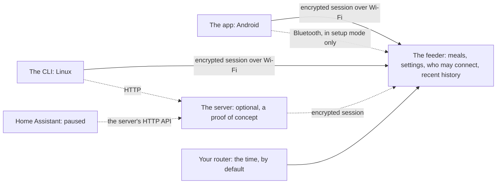
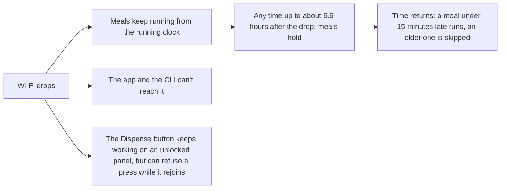
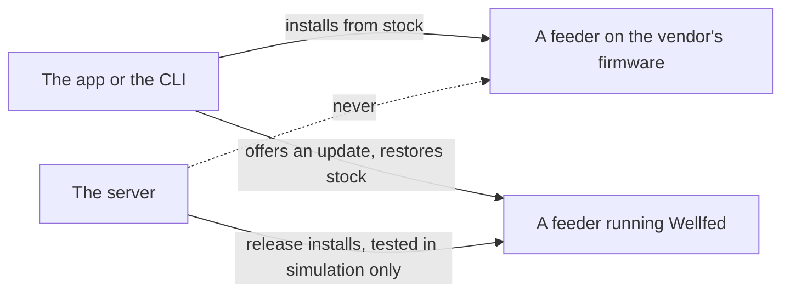

# The system at a glance

This page explains what the feeder, the app, the CLI and the optional server each do, and what keeps working when one of them is down. It is for owners deciding how much to run. For what's finished, see the [roadmap](../../roadmap.md).

## The one idea

The feeder owns its own state. Meals, settings, who may connect and recent history all live on the feeder, and the feeder decides when to feed. Everything else is a client that asks it, so losing a client loses that client's features, not your meals.

## The parts

| Part | What it does | What it doesn't do |
| --- | --- | --- |
| The feeder | Runs meals by itself, drives the motor, checks every request, and keeps its plans and recent history | Talk to a cloud. It never downloads anything from the internet: an update has to be offered by a client |
| The app | A screen for each thing the feeder offers, on Android: install, setup, meals, history, settings, people, updates and going back | Hold any meals or feeding logic of its own. It has no alerts yet: they're planned, and haven't been designed |
| The CLI | The same actions from a Linux computer, with text for people and JSON for scripts | Run as a service. It's one command at a time |
| The server | Adds long history, remote access, accounts, pets and food, and firmware releases. It's optional, and a heavy work in progress | Show a web page, or install from stock. The app doesn't connect to it yet |

The app and the CLI share their protocol code in Rust, so they can't disagree about what goes over the wire. Each phone or computer has its own key, and a feeder lists up to eight. [Who can talk to your feeder](access.md) covers those keys.

## Following one meal

Say you add a 07:30 meal from your phone.

1. The app sends the change over its encrypted session, naming the version of the meals it read. If someone else changed them meanwhile, the feeder refuses it and nothing is overwritten.
2. The feeder saves the meal to its own flash. From here the phone doesn't matter: you can turn it off.
3. The feeder polls your router for the time about every 17 minutes, by default.
4. At 07:30 the feeder starts the feed itself, through the same code as a Dispense press.
5. The result goes into the feeder's own history. The app reads it the next time it connects, and so does the server if you run one.

The feeder depends on two things in that list: the clock and its own flash. It doesn't need the phone, the CLI, the server or the internet, as long as something on your network keeps the clock set.

## What keeps working

The clock is the catch. The feeder has no battery-backed clock, and it keeps track of how far off it could be. Once that passes 2 minutes, the clock reads invalid and scheduled meals hold, rather than guess. That limit counts from the last time the clock was fully set, not from the last poll, so after Wi-Fi drops it can come any time up to about 6.6 hours later. Dispense still feeds on an unlocked panel, though a press can be refused while the feeder tries to rejoin.

| When this is down | Meals | The app and CLI, directly | What you lose |
| --- | --- | --- | --- |
| The server | Keep running | Keep working, on your network | Remote access and its history while it's down |
| The internet | Keep running if your router still answers with the time | Keep working, on your network | The clock, if your router stops answering or says its own clock isn't set. We haven't tested how routers behave here |
| Your router or Wi-Fi | Keep running until the clock's error passes 2 minutes, then hold | Can't reach the feeder | Everything over the network, until it's back |
| Your phone | Keep running | The other clients still work | Nothing, unless your phone was the clock's only source |
| Mains, no batteries | Don't run, and hold after it's back until the clock is set | Back when it's joined Wi-Fi | The clock. Plans and history are on flash |

[Everyday use](../everyday-use.md#when-something-is-down) has what to do in each case.

## Installing, and where the server stops

Installs from stock run only from the app or the CLI. Someone has to be at the feeder for the Reset hold, your phone or computer has to reach its setup network, and it serves the firmware itself. The server plays no part in that.

The server can install a firmware release on a feeder already running Wellfed, and keep a copy of its stock backup. So far those have run in simulation only. There's no release to install yet.

## The server, if you run one

The server adopts a feeder with an invite, and stores everything the feeder reports. An owner's invite gives it the feeder's full authority, so protect its data directory as you would your own key. [Running the server](../../server/running.md) covers setting it up.

The app will go through a server first once it can connect to one, and straight to the feeder when the server is down. That's a design, not something that runs today. A retry never crosses paths: a feed whose answer was lost on one path is never resent on the other, since that could feed twice. [Two paths, one feed](../../server/README.md#two-paths-one-feed) explains it.

## Home Assistant, maybe later

Home Assistant is paused until the server has proven itself on a real feeder. The route is chosen: an integration that calls the server's HTTP API, with one request id per press, so a replayed automation shouldn't feed twice. So it would need the server, but no code on the feeder and no feeder key of its own. Nothing exists yet.

## What this doesn't protect against

- **A long outage.** The feeder can only feed on schedule while it knows the time. A power cut with no time source, or a day without Wi-Fi, holds meals. No alert reaches you when that happens.
- **A wrong answer about the time.** The time from your router isn't authenticated. Someone on your network can shift a set clock only within its error bound, but whoever answers first can set a clock that has none. An owner's sync is the check. [Clock](../../firmware/clock.md#the-clock) has the limits.
- **Losing the phone that holds the keys.** If every client is lost, you need the recovery hold at the feeder. If the phone held the only backup of stock, that's gone with it.
- **An untested server.** Feeds, accounts and release installs through the server have run in simulation only. A phone talking to the feeder directly gets no events while the server is connected.
- **A different feeder.** All of this ran on one feeder.

## Evidence

- **Observed, October 28 and 29, 2026.** Plans ran on one research feeder with no server, and a plan due with no clock held. The server adopted the same feeder by invite, and kept its history whole across a server restart, a power cut and a Wi-Fi drop.
- **Observed, October 27, 2026.** Three time polls against a responder on the bench's network were used, about 17 minutes apart. The bench's responder isn't a home router, and no router has been tested.
- **Modeled, October 24 to 27, 2026.** Server feeds, accounts, release installs and the stock backup ran against the simulated feeder. The clock's expiry after a long uptime has run only in host tests.
- **Design, October 23 to 31, 2026.** Home Assistant's route, the app's path through a server, and that the server doesn't install from stock are the owner's decisions, in [product architecture](../../firmware/product-architecture.md).
