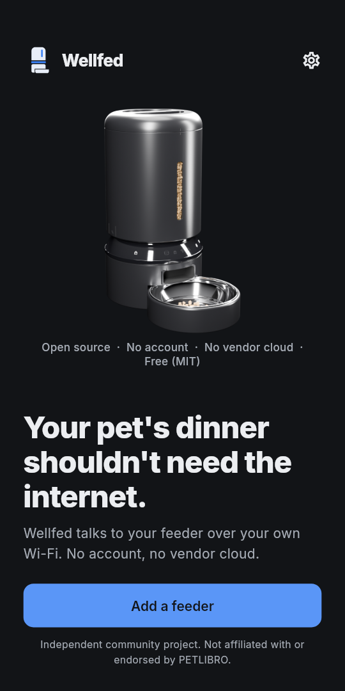
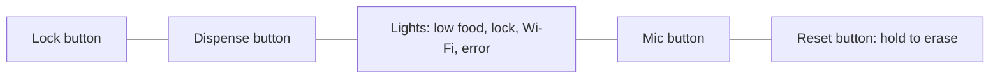
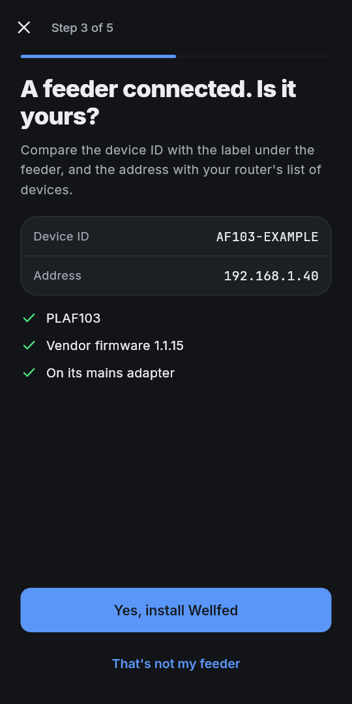
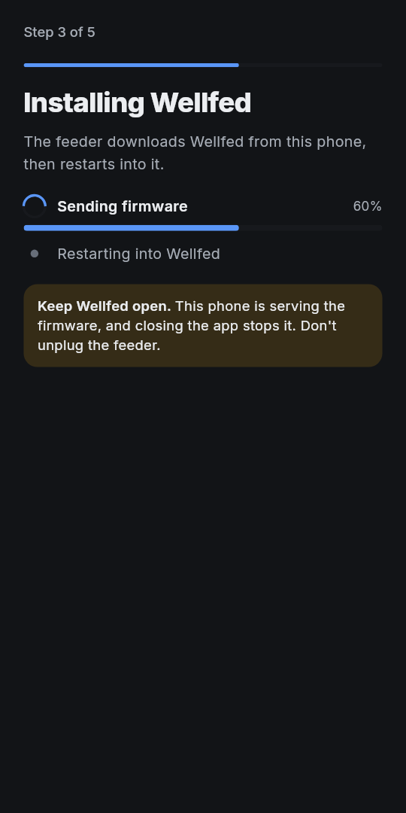
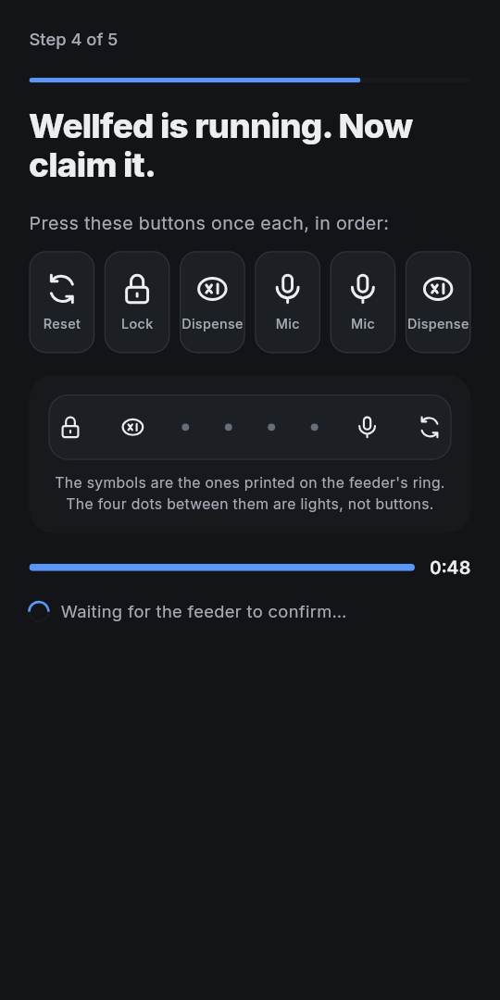
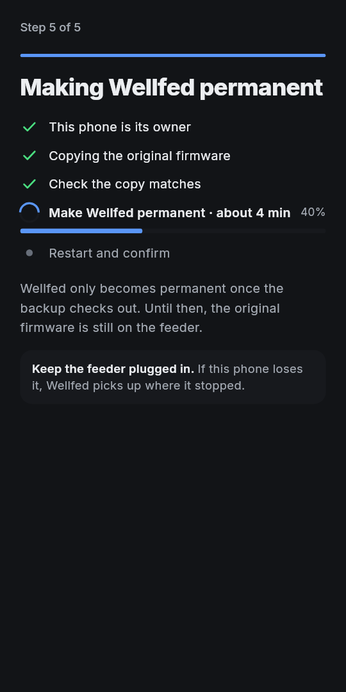

# Install

This page walks through moving a feeder from the vendor's firmware to Wellfed. It is for owners who have read [Before you start](before-you-start.md). The screenshots are drawn from the app with made-up details.

> [!NOTE]
> **You can't follow this yet.** There's no public build: no release has been published. Today the install only runs on our bench, from an image we build ourselves. This page shows what it will involve, and the [roadmap](../roadmap.md) shows when that changes.

The install has five steps and takes about 10 minutes. Keep the app open and the feeder plugged in for all of it.

## Start the install

**Don't hold Reset yet.** The app runs its own checks first, and it tells you when to hold it.

Tap **Add a feeder** and choose the install. Allow **Nearby devices** when Android asks, then enter your Wi-Fi name and password. The install needs Bluetooth in step 4 and won't go on without that permission.

## Step 1: Reset the feeder

Do this when the app asks.

> [!WARNING]
> This erases the feeder's meals, Wi-Fi, settings and link to the vendor's app, and only now can the installer read its firmware version. Check [Before you start](before-you-start.md#check-your-feeder) first. On a feeder already running Wellfed, this same hold wipes Wellfed instead, so don't use it to retry a later step.

1. If the lock light is on, hold the Lock button for 5 seconds.
2. Hold Reset, the rightmost button, for 5 seconds.

You should see the feeder restart. It then opens its own Wi-Fi network for setup, with a name starting with `PL-AF103`. That can take a minute to appear.

## Step 2: Tell the feeder how to reach you

Tap **Join the feeder's network**, and choose the `PL-AF103` network in Android's picker. The picker can be empty until the network is up. The app sends your Wi-Fi details and goes back to your own network.

On a computer, you switch networks yourself, since no desktop lets an app join one for you:

1. Open the computer's Wi-Fi menu and pick the `PL-AF103` network. The app watches for the switch and sends your Wi-Fi details once it sees it.
2. When the app says **Switch back**, rejoin your own network straight away. The feeder gives up if it can't reach your computer within about 20 seconds of joining your Wi-Fi.

Before it watches, the app checks two things. A VPN has to be off, since the feeder can't reach a VPN's address. And the computer mustn't already be on another network with `192.168.1.x` addresses, such as a guest network on a second adapter, since your Wi-Fi password would go to that network's router. The screen says which to change.

The app sends nothing until the computer itself says it joined a Wi-Fi network named `PL-AF103-…`. A Mac says so only to apps allowed your location, so allow Wellfed when macOS asks. On Windows 11, turn on Location for desktop apps in **Settings › Privacy & security › Location**. On Linux, the app asks NetworkManager or `iw`.

A computer with a cable to your router (or a second Wi-Fi adapter) is easier: it stays on your network throughout, so there's nothing to switch back. If your own network uses `192.168.1.x` addresses, as the feeder's does, the computer has to be fully off it while it sends, cable included.

Your password goes unencrypted over the feeder's open network for a few seconds. A network's name isn't proof it's a feeder's: anyone can name one `PL-AF103-…`, and neither this app nor the vendor's can tell. If the feeder doesn't connect within two minutes, the run stops with nothing installed. A wrong password or a network with no 2.4 GHz is the usual cause. On a computer, its firewall is the other: the feeder connects to it on TCP ports 1883 and 8088, and the stop screen says where your system allows them.

## Step 3: Confirm it's your feeder

The feeder joins your network and connects to your phone, not to the vendor. The installer now reads its model, firmware version and power source.

Compare the device ID with the label under the feeder, and the address with your router's list of devices. Then confirm. This matters because the first feeder to connect is the one that gets trusted. If a different feeder shows up, say no.

The feeder's own updater then downloads Wellfed from your phone and restarts into it. From this point, the vendor's firmware can't start again until it is restored from a good copy.

## Step 4: Claim it

Wellfed starts with no owner, and you prove you're at the feeder by pressing buttons on it.

The app finds the feeder over Bluetooth and shows six button presses. Press them once each, in order, before the countdown ends.

The code in this screenshot is an example. Yours will be different.

## Step 5: Make it permanent

The feeder copies the vendor's firmware to your phone, which checks that the copy matches the known 1.1.15 firmware. Only then does Wellfed overwrite it. This takes about 4 minutes, and there's nothing to press.

> [!WARNING]
> After this step, your backup is the only copy of your feeder's original firmware, and the feeder can't make another. Uninstalling the app or clearing its data deletes the app's copy.

When the install finishes, the app asks you to save the backup somewhere else: tap **Save the backup**, or **Not now**. Its only copy is on your phone until you do. You can also share it later from the app's settings, under **Firmware backups**, which lists every copy on the phone, including those of feeders you've removed.

## If the install stops

Follow what the stop screen offers, since the right move depends on where it stopped:

- **Once Wellfed is running**, you can pick up where it stopped.
- **If the installer doesn't know whether its request landed**, leave the feeder plugged in and wait. It listens for the answer and never resends that request, and a new one has to wait at least 20 minutes.
- **If stock's reports were lost**, the app may ask you to restart the feeder. That's the one time to unplug it during an install.

## Common mistakes

- **The feeder's network never appears.** Hold Reset again. If your phone set this feeder up in the vendor's app, forget that network in the phone's Wi-Fi settings first. If the panel ignores the hold, the vendor's app may have disabled the buttons: hold Lock for about 3 seconds, then Reset for about 3 seconds.
- **The app says two feeders answered.** Unplug the others and start again.
- **A computer slept or closed partway.** The app keeps the computer awake during the install, but closing the lid still sleeps it. Keep the lid open and the app running: closing the window asks first, since it stops the install wherever it is.

## Next steps

- Set up your meals again, and learn the buttons and lights: [Everyday use](everyday-use.md).
- Read [how the install protects your feeder, and where it can't](how-it-works/install-and-rollback.md).

## Evidence

- **Observed, October 30, 2026.** The app ran these steps on one research feeder from a real Reset hold, including a retry after a wrong password.
- **Modeled.** The install from a computer, with its switch of networks by hand, is tested on the host only and hasn't been run on a feeder. The 20 second window comes from stock's behavior with no answer to its binding request, not from a timed run from a computer.
- **Recovered.** The Lock and Reset sequence for disabled buttons comes from analysis of the vendor's firmware, and hasn't been pressed on the feeder.
- The screenshots are from an October 30 run. Device details are painted over. The setup code shown had expired.
