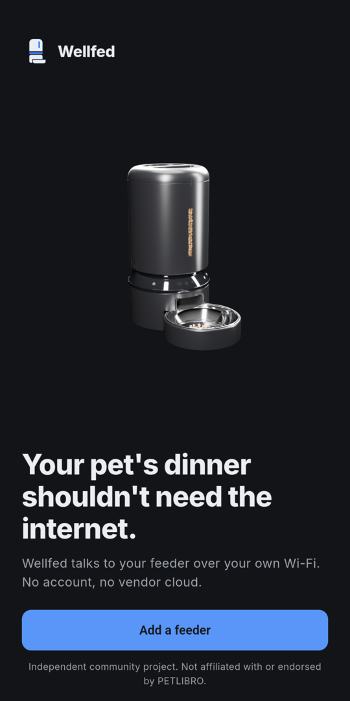
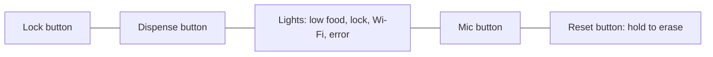
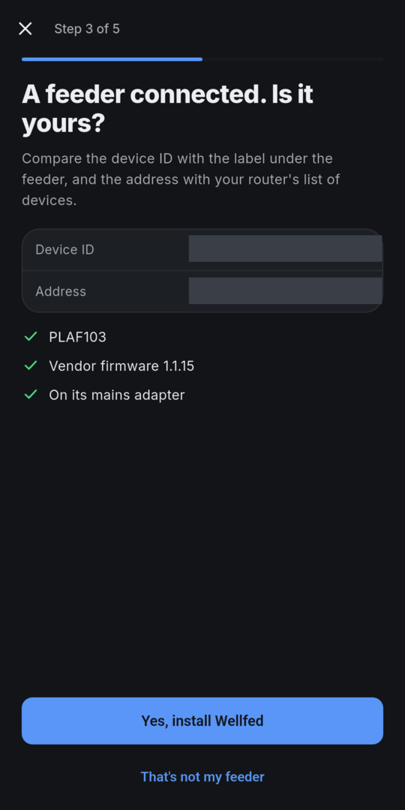
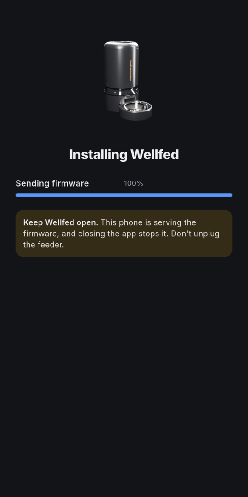
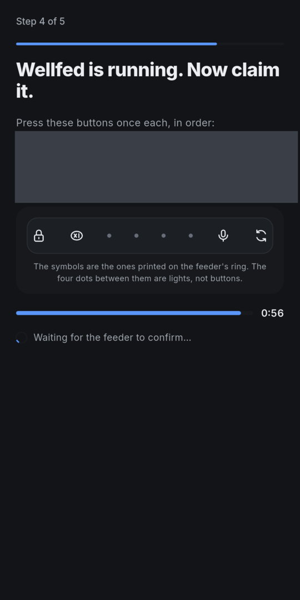
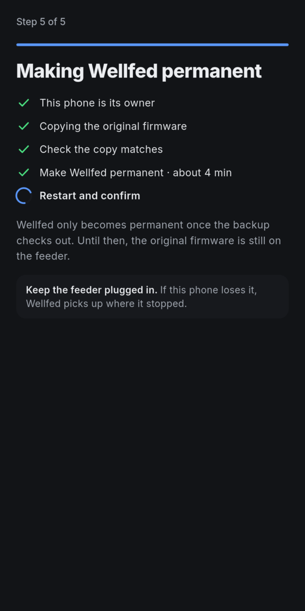

# Install

This page walks through moving a feeder from the vendor's firmware to Wellfed. It is for owners who have read [Before you start](before-you-start.md). The screens are from a run on our test feeder.

> [!NOTE]
> **You can't follow this yet.** There's no public build: no release exists, and the signing key a release needs hasn't been generated. Today the install only runs on our bench, from an image we build ourselves. This page shows what it will involve, and the [roadmap](../roadmap.md) shows when that changes.

The install has five steps and takes about 10 minutes. Keep the app or the run open and the feeder plugged in for all of it.

## Start the install

**Don't hold Reset yet.** The app and the CLI run their own checks first, and they tell you when to hold it.



<!-- tabs -->

### App

Tap **Add a feeder** and choose the install. Allow **Nearby devices** when Android asks, then enter your Wi-Fi name and password. The install needs Bluetooth in step 4 and won't go on without that permission.

### CLI

Run the installer, naming the build and your Wi-Fi network:

```sh
wellfed install --review <review> --manifest <manifest> --ssid <network>
```

It checks the build, its configuration and its address on your network before it asks you for anything.

<!-- /tabs -->

## Step 1: Reset the feeder

Do this when the app or the run asks.



> [!WARNING]
> This erases the feeder's meals, Wi-Fi, settings and link to the vendor's app, and only now can the installer read its firmware version. Check [Before you start](before-you-start.md#check-your-feeder) first. On a feeder already running Wellfed, this same hold wipes Wellfed instead, so don't use it to retry a later step.

1. If the lock light is on, hold the Lock button for 5 seconds.
2. Hold Reset, the rightmost button, for 5 seconds.

You should see the feeder restart. It then opens its own Wi-Fi network for setup, with a name starting with `PL-AF103`. That can take a minute to appear.

## Step 2: Tell the feeder how to reach you

<!-- tabs -->

### App

Tap **Join the feeder's network**, and choose the `PL-AF103` network in Android's picker. The picker can be empty until the network is up. The app sends your Wi-Fi details and goes back to your own network.

### CLI

On Linux with NetworkManager, the run moves your Wi-Fi interface to the feeder's network and back. Otherwise it tells you how to join. If you're connected over SSH on that interface, your session drops for a few seconds.

<!-- /tabs -->

Your password goes unencrypted over the feeder's open network for a few seconds. If the feeder doesn't connect within two minutes, the run stops with nothing installed. A wrong password or a network with no 2.4 GHz is the usual cause.

## Step 3: Confirm it's your feeder

The feeder joins your network and connects to your phone or computer, not to the vendor. The installer now reads its model, firmware version and power source.

Compare the device ID with the label under the feeder, and the address with your router's list of devices. Then confirm. This matters because the first feeder to connect is the one that gets trusted. If a different feeder shows up, say no.



The feeder's own updater then downloads Wellfed from your phone or computer and restarts into it. From this point, the vendor's firmware can't start again until it is restored from a good copy.



## Step 4: Claim it

Wellfed starts with no owner, and you prove you're at the feeder by pressing buttons on it.

<!-- tabs -->

### App

The app finds the feeder over Bluetooth and shows six button presses. Press them once each, in order, before the countdown ends.

### CLI

The run prints the six presses by button name and rings the terminal bell. Press them once each, in order, before the countdown ends. If the time runs out, it offers a new code, and nothing is lost.

<!-- /tabs -->



The code in this screenshot is from an old run and has expired. Yours will be different.

## Step 5: Make it permanent

The feeder copies the vendor's firmware to your phone or computer, which checks that the copy matches the known 1.1.15 firmware. Only then does Wellfed overwrite it. This takes about 4 minutes, and there's nothing to press.



> [!WARNING]
> After this step, your backup is the only copy of your feeder's original firmware, and the feeder can't make another. Uninstalling the app or clearing its data deletes the app's copy.

<!-- tabs -->

### App

Save the backup somewhere else when the app offers it. You can also share it later from the app's settings.

### CLI

Copy the backup somewhere safe:

```sh
wellfed backup export --output <file>
```

<!-- /tabs -->

## If the install stops

Follow what the stop screen offers, since the right move depends on where it stopped:

- **Once Wellfed is running**, you can pick up where it stopped. On the CLI that's `--from-bank0`.
- **If the installer doesn't know whether its request landed**, leave the feeder plugged in and wait. It listens for the answer and never resends that request, and a new one has to wait at least 20 minutes.
- **If stock's reports were lost**, the app may ask you to restart the feeder. That's the one time to unplug it during an install.

## Common mistakes

- **The feeder's network never appears.** Hold Reset again. If your phone set this feeder up in the vendor's app, forget that network in the phone's Wi-Fi settings first. If the panel ignores the hold, the vendor's app may have disabled the buttons: hold Lock for about 3 seconds, then Reset for about 3 seconds.
- **The app says two feeders answered.** Unplug the others and start again.

## Next steps

- Set up your meals again, and learn the buttons and lights: [Everyday use](everyday-use.md).
- Read [how the install protects your feeder, and where it can't](how-it-works/install-and-rollback.md).

## Evidence

- **Observed, October 30, 2026.** The app ran these steps on one research feeder from a real Reset hold, including a retry after a wrong password.
- **Observed, October 31, 2026.** The CLI ran them from stock on the same feeder and was resumed once after a setup code timed out. Its own hop onto the feeder's network hasn't run; the network was joined by hand.
- **Recovered.** The Lock and Reset sequence for disabled buttons comes from analysis of the vendor's firmware, and hasn't been pressed on the feeder.
- The screenshots are from an October 30 run. Device details are painted over. The setup code shown had expired.
